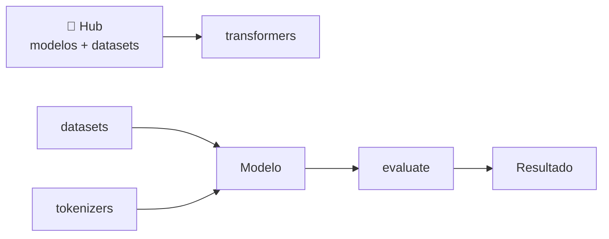
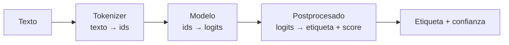

# MIA · RA2 — Apuntes: Hugging Face para usar modelos de IA

> Material de lectura y consulta del **RA2** (*utiliza modelos de sistemas de IA implementando sistemas de resolución de problemas*). Acompaña a las sesiones 01–03 del bloque.
>
> **Hilo conductor:** **SentimentLab**, una tienda online que quiere medir la satisfacción de sus clientes leyendo sus reseñas. A lo largo del bloque construimos, con Hugging Face, un sistema que clasifica reseñas (positiva/negativa) y, al final, lo afinamos con datos propios.

---

## 1 · Qué es Hugging Face y su ecosistema

Hugging Face (HF) es, hoy, la **plataforma de referencia del aprendizaje automático abierto**. No es una sola cosa, sino un **ecosistema** de piezas que encajan:

| Pieza | Qué es | Qué resuelve |
|---|---|---|
| **🤗 Hub** | Repositorio central de modelos, datasets y "Spaces" | Encontrar, compartir y versionar modelos |
| **`transformers`** | Librería Python para descargar y usar modelos | Inferencia y fine-tuning sin reimplementar nada |
| **`datasets`** | Librería para cargar y preparar datos | Obtener y transformar datasets de forma uniforme |
| **`tokenizers`** | Tokenizadores rápidos (Rust) | Convertir texto en números para el modelo |
| **`evaluate`** | Métricas estandarizadas | Evaluar modelos (accuracy, F1, BLEU…) |



La idea clave: **no entrenas desde cero**. Coges un modelo que ya sabe mucho (preentrenado), lo adaptas a tu problema. Esto se llama **transfer learning** y es el corazón del enfoque HF.

## 2 · El Hub: el catálogo de modelos

El [Hub](https://huggingface.co/models) es un GitHub de modelos. Cada modelo tiene:

- **Nombre** (`usuario/modelo`, p. ej. `distilbert-base-uncased`).
- **Ficha (model card):** qué hace, con qué datos se entrenó, licencia, limitaciones.
- **Archivos:** pesos (`pytorch_model.bin` o `model.safetensors`), `config.json`, `tokenizer`, etc.
- **Descargas** y **métricas** de uso.

Filtrar es esencial: hay cientos de miles de modelos. Los filtros clave son la **tarea** (classification, NER, summarization…) y la **licencia**.

!!! tip "Regla práctica"
    Antes de programar, ve al Hub, filtra por tu tarea y elige un modelo con una buena *model card*. El nombre suele indicar el modelo base y su tamaño (p. ej. `bert-base` vs `bert-large`, o `distilbert` = versión "destilada" y más ligera).

## 3 · `transformers` y las pipelines

### Qué es una pipeline

Una **pipeline** encadena, en una sola llamada, los pasos necesarios para resolver una tarea:



```python
# pip install transformers
from transformers import pipeline

clasificador = pipeline("sentiment-analysis")
clasificador("Me ha encantado el producto, llegó antes de tiempo.")
# [{'label': 'POSITIVE', 'score': 0.99}]
```

### Tareas habituales

| Tarea | `pipeline(...)` | Entrada → salida |
|---|---|---|
| Clasificación de texto | `"sentiment-analysis"` | texto → etiqueta + confianza |
| NER (entidades) | `"ner"` | texto → entidades (persona, lugar…) |
| Resumen | `"summarization"` | texto → resumen |
| Pregunta-respuesta | `"question-answering"` | (contexto, pregunta) → respuesta |
| Traducción | `"translation"` | texto → texto traducido |
| Relleno de huecos | `"fill-mask"` | texto con `[MASK]` → palabra |
| Generación | `"text-generation"` | prompt → texto generado |

### Elegir el modelo

`pipeline("tarea")` usa un **modelo por defecto**. Puedes —y normalmente debes— elegirlo explícitamente:

```python
clasificador = pipeline("sentiment-analysis", model="distilbert-base-uncased-finetuned-sst-2-english")
```

!!! note "¿Por qué importa elegir?"
    El modelo por defecto es genérico y en inglés. Para producción (o para español, o para un dominio concreto) eliges un modelo **afinado** a tu tarea e idioma.

## 4 · Tokenizadores

Un modelo de lenguaje no entiende texto: entiende **números**. El **tokenizador** traduce texto a una secuencia de **IDs de token**.

```python
from transformers import AutoTokenizer

tokenizer = AutoTokenizer.from_pretrained("distilbert-base-uncased")
salida = tokenizer("Hola, mundo")
print(salida)
# {'input_ids': [101, 7592, 1010, 2190, 102], 'attention_mask': [1, 1, 1, 1, 1]}
```

Cada número es un **token** (una palabra o, más a menudo, un **subtoken**). El `101` es un token especial de inicio (`[CLS]`) y `102` de fin (`[SEP]`), en los modelos BERT.

### Vocabulario y subtokens

El tokenizador tiene un **vocabulario** fijo (p. ej. 30 522 tokens en BERT). Las palabras que no están en el vocabulario se parten en subtokens:

```python
tokenizer.tokenize("tokenización")
# ['token', '##ización']   # '##' = continúa la palabra anterior
```

### `attention_mask` y padding

- **`attention_mask`:** indica qué tokens son reales (`1`) y cuáles son relleno (`0`), para que el modelo los ignore.
- **Padding:** al trabajar en *batch*, todas las secuencias deben medir igual; las cortas se rellenan con un token especial (`[PAD]`, id `0`).
- **Truncation:** las muy largas se cortan (los modelos tienen longitud máxima, p. ej. 512 tokens).

```python
tokenizer("Hola", padding=True, truncation=True, return_tensors="pt")
# devuelve tensores PyTorch listos para el modelo
```

## 5 · Modelos: `AutoModel`

La familia **`AutoModel*`** carga automáticamente la arquitectura correcta a partir del nombre del modelo en el Hub:

| Clase | Uso |
|---|---|
| `AutoModel` | El tronco del modelo, sin "cabeza" específica |
| `AutoModelForSequenceClassification` | + cabeza de clasificación |
| `AutoModelForTokenClassification` | + cabeza NER (token a token) |
| `AutoModelForQuestionAnswering` | + cabeza de QA |
| `AutoTokenizer` | El tokenizador que acompaña al modelo |

```python
from transformers import AutoModelForSequenceClassification

modelo = AutoModelForSequenceClassification.from_pretrained("distilbert-base-uncased")
```

El **flujo estándar** siempre es: cargar tokenizer y modelo **del mismo checkpoint**, tokenizar, y pasar los tensores al modelo.

## 6 · `datasets`

`datasets` carga datasets del Hub (o locales) de forma uniforme, con **splits** (train/test/validation) ya separados:

```python
from datasets import load_dataset

dataset = load_dataset("imdb")   # reseñas de películas: train + test
print(dataset)
# DatasetDict({train: 25000 ejemplos, test: 25000 ejemplos})
print(dataset["train"][0])       # {'text': '...', 'label': 1}
```

### Transformar un dataset

Con `.map()` se aplica una función a todos los ejemplos, de una vez:

```python
def tokenizar(ejemplo):
    return tokenizer(ejemplo["text"], truncation=True, padding="max_length")

tokenizado = dataset.map(tokenizar, batched=True)
```

- `batched=True` procesa por lotes (mucho más rápido).
- Los **columnas** resultantes (`input_ids`, `attention_mask`) se convierten en el *input* del modelo; `label` queda como objetivo.

### Trabajar con subconjuntos

Para clases rápidas (o Colab gratuito), es normal reducir el dataset:

```python
pequeno = dataset["train"].shuffle(seed=42).select(range(2000))
```

## 7 · Fine-tuning con `Trainer`

El **fine-tuning** es reentrenar un modelo preentrenado, durante pocas épocas, en tus datos. HF lo simplifica con el **`Trainer`**:

```python
from transformers import TrainingArguments, Trainer
import evaluate
import numpy as np

# 1) Modelo con cabeza para nuestra tarea
modelo = AutoModelForSequenceClassification.from_pretrained(
    "distilbert-base-uncased", num_labels=2
)

# 2) Argumentos de entrenamiento
args = TrainingArguments(
    output_dir="./resultados",
    evaluation_strategy="epoch",
    num_train_epochs=1,
    per_device_train_batch_size=16,
)

# 3) Métrica
accuracy = evaluate.load("accuracy")

def computar_metricas(eval_pred):
    logits, etiquetas = eval_pred
    preds = np.argmax(logits, axis=-1)
    return accuracy.compute(predictions=preds, references=etiquetas)

# 4) Entrenar
trainer = Trainer(
    model=modelo,
    args=args,
    train_dataset=tokenizado["train"],
    eval_dataset=tokenizado["test"],
    compute_metrics=computar_metricas,
)

trainer.train()
```

### Guardar, cargar y subir

```python
trainer.save_model("./mi_modelo")
# ... más tarde ...
from transformers import pipeline
clasificador = pipeline("sentiment-analysis", model="./mi_modelo")
```

Para **subirlo al Hub** (requiere `huggingface_hub` y login con token):

```python
modelo.push_to_hub("usuario/mi-modelo")
tokenizer.push_to_hub("usuario/mi-modelo")
```

## 8 · Evaluar modelos

`evaluate` centraliza métricas estandarizadas:

- **`accuracy`** — proporción de aciertos.
- **`f1`** — media armónica de precisión y exhaustividad (importante con clases desbalanceadas).
- **`precision` / `recall`** — por separado.

```python
import evaluate
acc = evaluate.load("accuracy")
acc.compute(predictions=[1, 0, 1], references=[1, 1, 1])
# {'accuracy': 0.666...}
```

!!! important "No basta con el accuracy"
    Si tus datos están desbalanceados (p. ej. 90 % positivas), un modelo que siempre predice "positiva" tiene accuracy 0.9 y no sirve. Mira **F1** y la **matriz de confusión**.

## 9 · El caso SentimentLab (resumen del bloque)

1. **Sesión 01 — Pipelines:** usamos un modelo preentrenado para clasificar reseñas sin entrenar nada.
2. **Sesión 02 — Tokenizers y Datasets:** entendemos qué hace el tokenizador y preparamos los datos para entrenar.
3. **Sesión 03 — Fine-tuning:** afinamos un modelo con reseñas propias de SentimentLab y lo evaluamos.

## Fuentes

- Documentación oficial de `transformers`: https://huggingface.co/docs/transformers
- Curso oficial de HF (NLP Course): https://huggingface.co/learn/nlp-course
- Documentación de `datasets`: https://huggingface.co/docs/datasets
- Documentación de `evaluate`: https://huggingface.co/docs/evaluate
