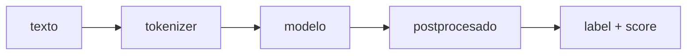

# Sesión 01 · Pipelines y modelos preentrenados (ejemplo)

> **Módulo / RA:** MIA (5071) · RA2 (*utiliza modelos de sistemas de IA*).
>
> **Criterios de evaluación (CE):** RA2-a (identificar modelos y su finalidad) · RA2-b (aplicar un modelo a la resolución de un problema).

> **Nota:** esta página es un **ejemplo de la plantilla** `legislacion/plantilla_sesion.md` rellena con un caso real (clasificación de sentimiento). Sirve como referencia para redactar las sesiones definitivas; su contenido aún es ilustrativo.

## Qué vas a aprender

| # | Al terminar la sesión serás capaz de… |
|---|---|
| 1 | Explicar qué es una **pipeline** y qué hace `transformers` por debajo |
| 2 | Descargar y usar un **modelo preentrenado** del Hub para una tarea concreta |
| 3 | Elegir el modelo adecuado según la **tarea** (clasificación, NER, resumen…) |

## Cuaderno de la sesión

El código se trabaja en el cuaderno **`sesion01_pipelines.ipynb`**:

[Abrir en Colab](https://colab.research.google.com/github/jmperez-profesor/hf/blob/main/docs/bloques/MIA_RA2/sesion01_pipelines.ipynb){ .md-button } · [ver en el sitio](sesion01_pipelines.ipynb)

## El caso / hilo conductor

**SentimentLab**, una tienda online que quiere medir la satisfacción del cliente leyendo sus reseñas. A lo largo del RA2 iremos construyendo, con Hugging Face, un sistema que clasifica reseñas (positiva/negativa) y, más adelante, lo afinaremos con datos propios.

## 1 · Qué es una pipeline

Una **pipeline** de `transformers` encadena los pasos necesarios para resolver una tarea: tokenización → modelo → postprocesado. Es la forma más rápida de usar un modelo preentrenado:

```python
# pip install transformers
from transformers import pipeline

clasificador = pipeline("sentiment-analysis")
resultado = clasificador("Me ha encantado el producto, llego antes de tiempo.")
print(resultado)
# [{'label': 'POSITIVE', 'score': 0.99}]
```



## 2 · Práctica guiada (con solución)

- Ejercicio: clasificar 5 reseñas reales y leer el `score` (confianza) de cada una.

## 3 · Práctica propuesta (miniproyecto)

- **Enunciado:** elegir 3 tareas del Hub (`text-classification`, `ner`, `summarization`) y probar un modelo distinto en cada una.
- **Entregable:** notebook `sesion01_pipelines.ipynb` ejecutado + una tabla comparando tarea, modelo y resultado.
- **Criterios:** tarea correcta (2 p), modelo adecuado (2 p), interpretación del resultado (1 p).

## Temporalización (120 min)

- **Apertura / activación (10 min):** presentar SentimentLab y qué es el Hub.
- **Desarrollo (80 min):** pipeline, elección de tarea/modelo, práctica guiada.
- **Cierre y evaluación (30 min):** miniproyecto y puesta en común.

## Materiales / recursos

- notebook: `practicas/MIA_RA2_sesion01.ipynb`
- Documentación oficial: https://huggingface.co/docs/transformers/pipeline_tutorial
- Curso oficial: https://huggingface.co/learn/nlp-course

## Evaluación (criterios CE)

- Identifica la tarea y el modelo correcto (RA2-a); aplica un modelo a un caso real (RA2-b).

## Atención a la diversidad / diferenciación

- Ampliación: usar `tokenizer` y modelo por separado (sin pipeline) para ver los pasos.

## Observaciones

- Instalar `transformers` en el Colab la primera vez (`%pip install transformers`).
