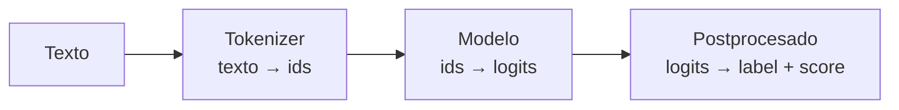

# Sesión 01 · Pipelines y modelos preentrenados

> **Módulo / RA:** MIA (5071) · **RA2** (*utiliza modelos de sistemas de IA implementando sistemas de resolución de problemas*).
>
> **Criterios de evaluación (CE):** identificar modelos y su finalidad; aplicar un modelo preentrenado a un problema concreto.

## Qué vas a aprender

| # | Al terminar la sesión serás capaz de… |
|---|---|
| 1 | Explicar qué es Hugging Face y qué piezas componen su ecosistema |
| 2 | Buscar y elegir un modelo en el Hub según la tarea y el idioma |
| 3 | Usar una `pipeline` para resolver tareas de NLP sin entrenar nada |
| 4 | Describir qué hace `transformers` por debajo (tokenizar → modelo → postprocesar) |

## Cuaderno de la sesión

El código se trabaja en el cuaderno **`sesion01_pipelines.ipynb`**:

[Abrir en Colab](https://colab.research.google.com/github/jmperez-profesor/hf/blob/main/docs/bloques/MIA_RA2/sesion01_pipelines.ipynb){ .md-button } · [ver en el sitio](sesion01_pipelines.ipynb)

## El caso: SentimentLab

**SentimentLab** es una tienda online que quiere medir la satisfacción de sus clientes leyendo sus reseñas. A lo largo del RA2 construiremos, con Hugging Face, un sistema que clasifica reseñas en **positiva** o **negativa**. En esta primera sesión lo hacemos **sin entrenar nada**: usamos un modelo ya afinado del Hub.

## 1 · El ecosistema Hugging Face

Hugging Face no es una librería, es un **ecosistema** (ver `apuntes.md` §1): el **Hub** (catálogo de modelos y datasets) + las librerías `transformers`, `datasets`, `tokenizers` y `evaluate`.

El principio que lo vertebra es el **transfer learning**: no entrenas desde cero, reutilizas modelos que ya saben mucho.

## 2 · Una pipeline en 3 líneas

```python
# pip install transformers
from transformers import pipeline

clasificador = pipeline("sentiment-analysis")
print(clasificador("Me ha encantado el producto, llegó antes de tiempo."))
# [{'label': 'POSITIVE', 'score': 0.999...}]
```

Una `pipeline` encadena tres pasos que ocurren de forma invisible:



## 3 · El postprocesado: leer el `score`

El resultado trae dos cosas: la **`label`** (etiqueta) y el **`score`** (confianza del modelo, entre 0 y 1).

```python
for reseña in ["Pésimo, llegó roto y tardó una semana",
               "Excelente compra, repetiré seguro"]:
    print(clasificador(reseña)[0])
# {'label': 'NEGATIVE', 'score': 0.999...}
# {'label': 'POSITIVE', 'score': 0.999...}
```

!!! warning "El score NO es probabilidad calibrada"
    `score` indica la confianza *relativa* del modelo, no una probabilidad exacta. Un `0.7` no significa "70 % de posibilidades": es solo la salida del softmax. No lo interpretes como certeza real.

## 4 · Otras tareas con una sola llamada

`pipeline` cubre muchas tareas cambiando solo el primer argumento:

```python
ner = pipeline("ner")
print(ner("Apple abrió una tienda en Valencia."))

resumen = pipeline("summarization")
print(resumen("...texto largo...", max_length=30))
```

## 5 · Elegir el modelo en el Hub

`pipeline("tarea")` usa un modelo por defecto (genérico, en inglés). Para SentimentLab elegimos uno **afinado** y, si hay reseñas en español, uno **multilingüe**:

```python
clasificador = pipeline(
    "sentiment-analysis",
    model="nlptown/bert-base-multilingual-uncased-sentiment",  # ejemplo multilingüe
)
```

En el Hub, filtra por **tarea**, **idioma** y **licencia**, y lee la *model card* antes de usarlo.

## Temporalización (120 min)

- **Apertura (10 min):** presentar SentimentLab y el ecosistema HF.
- **Desarrollo (80 min):** pipeline, postprocesado, tareas, elección de modelo.
- **Cierre (30 min):** práctica propuesta + puesta en común.

## Práctica guiada (con solución)

Clasifica estas 3 reseñas y describe qué `label` y `score` devuelve cada una. ¿Cuál es la menos "segura" para el modelo?

```python
reseñas = [
    "El pedido llegó rápido y en perfecto estado.",
    "No me gustó nada, lo devolví.",
    "Bueno, cumple su función, nada del otro mundo.",
]
```

??? tip "Solución"
    La tercera es la más ambigua y suele devolver un `score` más bajo (p. ej. `0.6`) porque el modelo no la ve claramente positiva ni negativa. Las dos primeras suelen tener `score` alto (≈ 0.99).

## Práctica propuesta (miniproyecto)

- **Enunciado:** elige **3 tareas distintas** del Hub (`text-classification`, `ner`, `summarization`) y prueba un modelo en cada una con un texto tuyo.
- **Entregable:** notebook `sesion01_pipelines.ipynb` ejecutado + tabla comparando **tarea, modelo, entrada, salida**.
- **Criterios:** tarea correcta (2 p), modelo adecuado (2 p), interpretación del resultado (1 p).

## Ejercicios de autoevaluación

**1.** Nombra las piezas del ecosistema Hugging Face y qué resuelve cada una.

??? tip "Solución 1"
    **Hub** (catálogo de modelos/datasets) · **`transformers`** (descargar y usar modelos) · **`datasets`** (cargar y preparar datos) · **`tokenizers`** (texto → números) · **`evaluate`** (métricas).

**2.** ¿Qué es una *pipeline* y qué tres pasos encadena?

??? tip "Solución 2"
    Encadena **tokenización** (texto → ids), **modelo** (ids → logits) y **postprocesado** (logits → etiqueta + confianza) en una sola llamada.

**3.** ¿Por qué casi nunca conviene usar el modelo por defecto de `pipeline`?

??? tip "Solución 3"
    Porque es genérico y suele estar en inglés. Para un dominio o idioma concretos conviene elegir un modelo **afinado** a la tarea (ver la *model card* en el Hub).

**4.** ¿Qué diferencia hay entre `label` y `score`?

??? tip "Solución 4"
    `label` es la etiqueta predicha (p. ej. `POSITIVE`); `score` es la confianza relativa del modelo (0–1), que **no** debe leerse como probabilidad calibrada.

## Observaciones

- Primera vez: `%pip install transformers` en el Colab.
- Si un modelo tarda o da error de descarga, probar con `distilbert` (más ligero).
