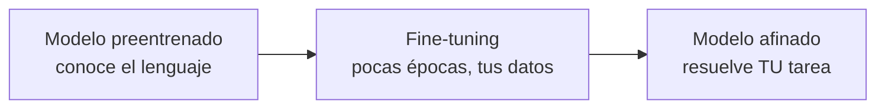

# Sesión 03 · Fine-tuning y evaluación

> **Módulo / RA:** MIA (5071) · **RA2** (*utiliza modelos de sistemas de IA implementando sistemas de resolución de problemas*).
>
> **Criterios de evaluación (CE):** adaptar (afinar) un modelo preentrenado a un problema; evaluar el modelo con métricas.

## Qué vas a aprender

| # | Al terminar la sesión serás capaz de… |
|---|---|
| 1 | Explicar qué es el **fine-tuning** y por qué no entrenas desde cero |
| 2 | Montar un `Trainer` con `TrainingArguments` y una métrica de `evaluate` |
| 3 | Afinar un modelo de clasificación sobre tus datos |
| 4 | Evaluar con `accuracy`/`F1` y guardar (y subir) el modelo |

## Cuaderno de la sesión

El código se trabaja en el cuaderno **`sesion03_finetuning.ipynb`**:

[Abrir en Colab](https://colab.research.google.com/github/jmperez-profesor/hf/blob/main/docs/bloques/MIA_RA2/sesion03_finetuning.ipynb){ .md-button } · [ver en el sitio](sesion03_finetuning.ipynb)

## El caso: el modelo propio de SentimentLab

Cierra el bloque: en la sesión 01 usamos un modelo ajeno, en la 02 preparamos los datos, y ahora **afinamos un modelo con las reseñas de SentimentLab** y lo evaluamos.

## 1 · Qué es el fine-tuning

El **fine-tuning** (o *transfer learning*) parte de un modelo **preentrenado** (que ya conoce el lenguaje) y lo **reentrena poco tiempo** con tus datos, adaptando solo lo necesario:



Ventajas frente a entrenar desde cero: **mucho menos dato**, **menos tiempo** y **mejores resultados**.

## 2 · Modelo con cabeza de clasificación

```python
from transformers import AutoModelForSequenceClassification

modelo = AutoModelForSequenceClassification.from_pretrained(
    "distilbert-base-uncased", num_labels=2
)
```

`num_labels=2` añade una **cabeza de clasificación** nueva (para "positiva"/"negativa") sobre el tronco preentrenado.

## 3 · Argumentos de entrenamiento

```python
from transformers import TrainingArguments

args = TrainingArguments(
    output_dir="./resultados",
    evaluation_strategy="epoch",   # evalúa al final de cada época
    num_train_epochs=1,
    per_device_train_batch_size=16,
    logging_steps=50,
)
```

## 4 · Métrica con `evaluate`

```python
import evaluate
import numpy as np

accuracy = evaluate.load("accuracy")

def computar_metricas(eval_pred):
    logits, etiquetas = eval_pred
    preds = np.argmax(logits, axis=-1)   # el índice de mayor logit
    return accuracy.compute(predictions=preds, references=etiquetas)
```

!!! note "De logits a predicción"
    El modelo devuelve **logits** (puntuaciones por clase), no etiquetas. `np.argmax` toma la clase de mayor puntuación.

## 5 · Entrenar con `Trainer`

```python
from transformers import Trainer

trainer = Trainer(
    model=modelo,
    args=args,
    train_dataset=tokenizado["train"],   # de la sesión 02
    eval_dataset=tokenizado["test"],
    compute_metrics=computar_metricas,
)

trainer.train()
trainer.evaluate()   # devuelve {'eval_loss': ..., 'eval_accuracy': ...}
```

## 6 · Guardar, reutilizar y subir

```python
trainer.save_model("./sentimentlab")
# ... reutilizar ...
from transformers import pipeline
clasificador = pipeline("sentiment-analysis", model="./sentimentlab")

# subir al Hub (requiere token: huggingface-cli login)
modelo.push_to_hub("tu-usuario/sentimentlab")
tokenizer.push_to_hub("tu-usuario/sentimentlab")
```

## 7 · Evaluar de verdad: no solo accuracy

Con clases desbalanceadas, el `accuracy` engaña. Mira también **F1**:

```python
f1 = evaluate.load("f1")
# usa preds y etiquetas igual que accuracy
```

!!! important "Sentido crítico"
    Un modelo que siempre dice "positiva" sobre un dataset con 90 % positivas tiene accuracy 0.9. La **matriz de confusión** y el **F1** revelan que no aprende nada. Evalúa siempre con más de una métrica.

## Temporalización (120 min)

- **Apertura (10 min):** qué es fine-tuning y por qué.
- **Desarrollo (80 min):** Trainer, métricas, entrenamiento.
- **Cierre (30 min):** práctica propuesta + puesta en común.

## Práctica guiada (con solución)

¿Qué cambia si pones `num_train_epochs=3` en lugar de `1`? ¿Qué riesgo aparece?

??? tip "Solución"
    El modelo ve los datos 3 veces. Suele subir el accuracy, pero con riesgo de **sobreajuste (overfitting)**: aprende de memoria los ejemplos de entrenamiento y generaliza peor a datos nuevos. Para detectarlo, compara la métrica de *train* frente a la de *eval*.

## Práctica propuesta (miniproyecto)

- **Enunciado:** afina `distilbert-base-uncased` sobre un subconjunto de `imdb` (p. ej. 1000 train / 200 test), 1 época, y evalúa con accuracy y F1.
- **Entregable:** notebook `sesion03_finetuning.ipynb` ejecutado + una celda final comentando los resultados.
- **Criterios:** Trainer correcto (2 p), métricas computadas (2 p), interpretación (1 p).

## Ejercicios de autoevaluación

**1.** ¿Qué es el fine-tuning y qué ventaja tiene frente a entrenar desde cero?

??? tip "Solución 1"
    Reentrenar poco tiempo un modelo **preentrenado** con tus datos. Ventajas: menos datos, menos tiempo y mejores resultados, porque reutiliza el conocimiento previo.

**2.** ¿Para qué sirve `num_labels` en `AutoModelForSequenceClassification`?

??? tip "Solución 2"
    Define el tamaño de la **cabeza de clasificación** nueva (número de clases). El tronco se mantiene preentrenado.

**3.** ¿Qué devuelve el modelo y qué hace `np.argmax`?

??? tip "Solución 3"
    Devuelve **logits** (puntuaciones por clase). `np.argmax` toma el índice de la clase con mayor puntuación para convertirlos en predicciones.

**4.** ¿Por qué el accuracy puede ser engañoso con clases desbalanceadas?

??? tip "Solución 4"
    Porque predecir siempre la clase mayoritaria ya da un accuracy alto sin aprender nada. Conviene mirar **F1** y la matriz de confusión.

**5.** ¿Qué comando guarda el modelo afinado y cómo lo reutilizas?

??? tip "Solución 5"
    `trainer.save_model("./ruta")`. Para reutilizarlo: `pipeline("sentiment-analysis", model="./ruta")` o `AutoModelForSequenceClassification.from_pretrained("./ruta")`.

## Observaciones

- En Colab gratuito, usa subconjuntos pequeños y `per_device_train_batch_size` bajo.
- `huggingface-cli login` y un token son necesarios solo para **subir** al Hub.
