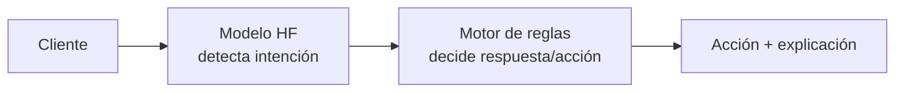
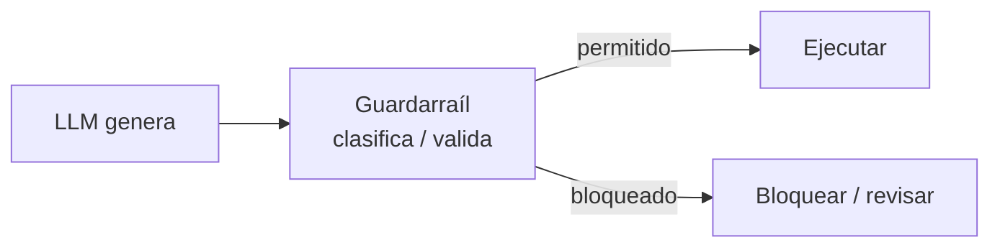

# MIA · RA5 — Apuntes: Modelos de Hugging Face en sistemas expertos y guardarraíles

> Material de lectura y consulta del **RA5** (*aplica sistemas expertos evaluando la influencia de los controladores inteligentes en el comportamiento del sistema*). Acompaña a la sesión 01 del bloque.
>
> **Hilo conductor:** un **chatbot de soporte** de SentimentLab que debe **entender** la intención del cliente (modelo de lenguaje) y **decidir** qué hacer con **reglas** (sistema experto). La clave: cómo conviven ambos.

---

## 1 · Dos formas de decidir

| Enfoque | Cómo decide | Explicabilidad | Cuándo usarlo |
|---|---|---|---|
| **Sistema experto (reglas)** | Reglas `SI…ENTONCES…` + motor de inferencia | Alta (muestra la regla) | Política de negocio, límites, compliance |
| **Modelo de ML (HF)** | Aprende de datos | Baja (caja negra) | Percepción: entender texto, imagen… |

El punto importante: **no compiten, se complementan**. Un sistema moderno combina ambos.

## 2 · Sistemas híbridos (neuro-simbólicos)

Un **sistema híbrido** (o neuro-simbólico) usa:

- **Modelos** (HF) para **percibir**: clasificar, extraer entidades, detectar intención.
- **Reglas** para **decidir**: qué hacer con esa percepción, con explicación y auditoría.



Ejemplo: el chatbot detecta que la intención es *"reclamación"* (modelo) y una regla dice *"si reclamación → escalar a humano"* (motor de reglas).

## 3 · Guardarraíles (guardrails)

Un **guardarraíl** es una capa que **valida y acota** la salida de un modelo antes de que actúe. Con LLM generativos es esencial: el modelo propone, el guardarraíl decide si se permite.



Tipos de guardarraíl con HF:

- **Clasificador de intención/tema:** asegura que la respuesta es del dominio permitido.
- **Clasificador de toxicidad:** bloquea salidas ofensivas.
- **Detector de entidades:** comprueba que no se filtran datos sensibles (PII).

## 4 · Zero-shot classification como guardarraíl

`transformers` incluye `zero-shot-classification`: clasifica un texto en **etiquetas arbitrarias** sin entrenar, comparándolo con descripciones de cada etiqueta:

```python
from transformers import pipeline

clasificador = pipeline("zero-shot-classification")

texto = "Quiero devolver un producto que llegó roto"
etiquetas = ["consulta", "reclamacion", "compra", "despedida"]

print(clasificador(texto, etiquetas))
# {'labels': ['reclamacion', 'consulta', ...], 'scores': [0.9, 0.08, ...]}
```

Es el guardarraíl perfecto: el chatbot usa estas **scores** como hechos que alimentan el **motor de reglas**.

## 5 · Uniendo todo: chatbot híbrido con guardarraíl

```python
INTENCION = clasificador(texto, ["consulta", "reclamacion", "compra"])

# "motor de reglas" sencillo
def decidir(intencion):
    reglas = {
        "reclamacion": "Escalar a agente humano",
        "compra":       "Ayudar a finalizar la compra",
        "consulta":     "Responder con el FAQ",
    }
    return reglas[intencion]
```

- El **modelo HF** aporta percepción (intención) con su confianza.
- Las **reglas** aportan la decisión, **explicable** y auditable.

## 6 · Sensibilidad y robustez (RA5)

- **Sensibilidad:** cómo cambia la decisión ante pequeñas variaciones de la entrada. Un umbral de confianza muy estricto hace el sistema sensible (más bloqueos).
- **Robustez:** mantener decisiones estables ante ruido o entradas ligeramente distintas.
- Ajustar el **umbral** del guardarraíl (p. ej. `score < 0.5 → pedir aclaración`) equilibra ambas.

## Fuentes

- `zero-shot-classification`: https://huggingface.co/docs/transformers/tasks/zero_shot_classification
- Modelos de toxicidad/moderación en el Hub (p. ej. `unitary/toxic-bert`).
