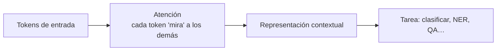

# PIA · RA3 — Apuntes: Procesamiento de lenguaje natural con Hugging Face

> Material de lectura y consulta del **RA3** de PIA (5072) (*procesamiento de lenguaje natural*; enunciado oficial pendiente de verificar contra el RD 279/2021). Acompaña a las sesiones 01–02 del bloque.

---

## 1 · Qué es el PLN y por qué es difícil

El **procesamiento de lenguaje natural (PLN / NLP)** es la rama de la IA que hace que las máquinas **entiendan y generen** lenguaje humano. Es difícil porque el lenguaje es:

- **Ambiguo:** "Vi al hombre con el telescopio" (¿quién lo llevaba?).
- **Dependiente del contexto:** el significado cambia con la frase y la situación.
- **No estructurado:** no es una tabla de números, es texto libre.

## 2 · Tareas principales de PLN

| Tarea | Entrada → salida | Ejemplo |
|---|---|---|
| **Clasificación de texto** | texto → categoría | spam/no spam, sentimiento |
| **NER (entidades)** | texto → entidades | persona, lugar, organización |
| **Question answering (QA)** | (contexto, pregunta) → respuesta | responder sobre un documento |
| **Resumen** | texto largo → texto corto | titulares, resúmenes |
| **Generación** | prompt → texto | redactar, completar |
| **Traducción** | texto → texto | es → en |
| **Relleno de huecos** | texto con `[MASK]` → palabra | "El `[MASK]` es un animal" |

## 3 · Por qué los Transformers cambiaron el PLN

Antes de 2017, el PLN usaba redes recurrentes (LSTM/RNN) que leían el texto **secuencialmente**, palabra a palabra. Eso era lento y olvidaba contextos largos.

El **Transformer** (paper *Attention is All You Need*, 2017) introduce la **atención**:



La idea clave: **cada palabra se representa teniendo en cuenta todas las demás** de la frase, de golpe (paralelo), en vez de una a una. Esto captura mejor el contexto y entrena mucho más rápido.

!!! note "No necesitas la fórmula, sí la idea"
    En este curso basta con entender **qué aporta** la atención (contexto global, paralelismo) y que todo el PLN moderno se apoya en Transformers. Los detalles matemáticos quedan fuera de alcance.

## 4 · Transfer learning en PLN

El mismo patrón del RA2, aplicado al lenguaje:

1. **Preentrenamiento:** un modelo (BERT, RoBERTa, etc.) aprende el lenguaje en textos masivos, con tareas tipo "rellenar huecos".
2. **Fine-tuning:** se adapta a una tarea concreta (clasificar, NER…) con pocos datos.

Por eso en el Hub ves `bert-base-uncased` (preentrenado, genérico) y `*-finetuned-*` (adaptado a una tarea).

## 5 · Tareas en detalle

### Clasificación de texto

Asigna una **categoría** a un texto. Casos: spam, sentimiento, tema, intención.

```python
clasificador = pipeline("sentiment-analysis")
clasificador("Me encanta este curso")
```

### NER (Named Entity Recognition)

Detecta **entidades** (persona, organización, lugar…) dentro del texto. Es clasificación **token a token**.

```python
ner = pipeline("ner")
ner("Apple abrió una tienda en Valencia")
# [{'entity': 'ORG', 'word': 'Apple'}, {'entity': 'LOC', 'word': 'Valencia'}]
```

### Question answering (extractiva)

Dado un **contexto** y una **pregunta**, extrae la respuesta del propio contexto.

```python
qa = pipeline("question-answering")
qa(question="¿Dónde abrió Apple la tienda?", context="Apple abrió una tienda en Valencia")
# {'answer': 'Valencia', ...}
```

### Resumen

Condensa un texto largo en uno corto.

```python
resumidor = pipeline("summarization")
resumidor("...texto largo...", max_length=30)
```

### Generación

Produce texto nuevo a partir de un prompt.

```python
gen = pipeline("text-generation")
gen("Escribe una frase de bienvenida para una tienda:", max_new_tokens=30)
```

## 6 · Elegir el modelo según la tarea y el idioma

En el Hub filtra por **tarea** e **idioma**. Para español, busca modelos multilingües (`*-multilingual-*`) o entrenados específicamente en español (p. ej. `dccuchile/bert-base-spanish-wwm-uncased` para clasificación tras fine-tuning).

## Fuentes

- Curso oficial de HF (NLP Course): https://huggingface.co/learn/nlp-course
- *Attention is All You Need* (Vaswani et al., 2017): https://arxiv.org/abs/1706.03762
- Documentación de tareas de `transformers`: https://huggingface.co/docs/transformers/tasks/sequence_classification
