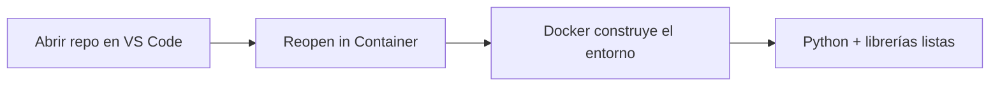

# Entorno de trabajo

El curso se puede seguir con **tres entornos**. Elige según la sesión y tus preferencias:

| Entorno | Cuándo | GPU | Configuración |
|---|---|---|---|
| **Google Colab** | Por defecto | ✅ gratis (T4) | Ninguna |
| **Entorno virtual local** (`venv`/`uv`) | Sesiones que no necesitan GPU | ❌ | 2 min |
| **DevContainer (VS Code)** | Flujo "de empresa" / reproducible | ⚠️ opcional | Docker + VS Code |

> El **mismo código** funciona en los tres: los notebooks son idénticos. Solo cambia dónde se ejecutan.

---

## 1 · Google Colab (por defecto)

Cada sesión tiene un notebook con el botón **"Abrir en Colab"**. Es la opción más rápida: GPU gratis y cero instalación.

- Activa la GPU: **Runtime → Change runtime type → T4 GPU** (solo la necesitas en fine-tuning y visión/audio).
- Instala librerías con `%pip install ...` en la primera celda.

## 2 · Entorno virtual local (`venv` / `uv`)

Para ejecutar el código en tu máquina (sesiones de CPU: tokenizadores, datasets, transformers, Gradio).

!!! important "Un solo entorno para todo el curso"
    Crea **un único entorno** y reutilízalo en todas las sesiones. **No** crees uno por sesión: cada entorno trae su propia copia de `torch` (2-5 GB) y eso es lo que llena el disco. Los ejercicios van en subcarpetas:

    ```
    hf/
    ├── .venv/                  ← el único entorno virtual
    ├── course-requirements.txt
    ├── sesion29/
    ├── sesion31/
    └── ...
    ```

    En cada sesión solo tienes que **reactivar** el entorno: `source .venv/bin/activate`.

### Opción A · `venv` (clásico)

```bash
# 1. Crear el entorno (en la carpeta del repositorio)
python3 -m venv .venv

# 2. Activarlo
source .venv/bin/activate     # Linux / macOS
# .venv\Scripts\activate      # Windows (PowerShell)

# 3. Instalar las dependencias del curso
pip install -r course-requirements.txt
```

### Opción B · `uv` (moderno, más rápido — recomendado)

[`uv`](https://docs.astral.sh/uv/) es el gestor de entornos que está sustituyendo a `pip`/`venv`. Instálalo una vez y crea entornos en segundos:

```bash
# Instalar uv (Linux/macOS)
curl -LsSf https://astral.sh/uv/install.sh | sh
# Windows: winget install astral-sh.uv

# Crear el entorno y activarlo
uv venv
source .venv/bin/activate     # .venv\Scripts\activate en Windows

# Instalar dependencias (mucho más rápido que pip)
uv pip install -r course-requirements.txt
```

!!! tip "Comprobar que funciona"
    Tras activar el entorno, ejecuta `python` y prueba:
    ```python
    from transformers import pipeline
    print(pipeline("sentiment-analysis")("Me encanta este curso"))
    ```

## 3 · DevContainer en VS Code (flujo de empresa)

Un **DevContainer** es un contenedor Docker con todo el entorno preconfigurado. Todo el mundo trabaja en el **mismo entorno**, reproducible y aislado. Es lo que usan los equipos de ingeniería ML.

### Requisitos (una sola vez)

1. Instala [Docker Desktop](https://www.docker.com/products/docker-desktop/).
2. Instala [VS Code](https://code.visualstudio.com/) y la extensión **"Dev Containers"** (`ms-vscode-remote.remote-containers`).

### Usarlo

1. Clona el repositorio y ábrelo en VS Code.
2. VS Code detecta el fichero `.devcontainer/devcontainer.json` y sugiere **"Reopen in Container"**.
3. Pulsa el botón. Se construye el contenedor y **se instalan las dependencias automáticamente** (de `course-requirements.txt`).
4. Ya tienes Python + las librerías + Jupyter listos, sin tocar tu sistema.



### ¿Y la GPU?

El contenedor por defecto usa **CPU** (suficiente para casi todo el curso). Para GPU en local haría falta una imagen con CUDA y el *NVIDIA Container Toolkit*, más complejo. Por eso las sesiones pesadas (fine-tuning, visión) se hacen en **Colab**, y el DevContainer queda para las de CPU.

---

## Gestionar el espacio en disco

El disco se llena por **dos motivos distintos**, y solo uno se arregla con los entornos:

| Qué ocupa | Dónde vive | Cómo se gestiona |
|---|---|---|
| **Librerías** (`torch`, `transformers`, …) | dentro del `.venv` | **un solo entorno** (no duplicar) |
| **Modelos descargados** | `~/.cache/huggingface/` (global) | `hf cache scan` / `hf cache delete` |

Los modelos de HF se guardan en una **caché global** compartida entre todos los entornos. Para ver cuánto ocupan y limpiarlos:

```bash
hf cache scan                 # cuánto ocupa cada modelo
hf cache delete <modelo>      # borra un modelo que ya no uses
```

> **Rutina recomendada:** al final de cada trimestre (o del curso), ejecuta `hf cache scan`, mira qué modelos ya no necesitas y bórralos con `hf cache delete`. En **Colab** no hay que preocuparse: la caché es efímera (se borra entre sesiones).

---

## Probar transformers v4 y v5 (hola-traductor)

Para comprobar la diferencia entre versiones, separamos los entornos:

| Entorno | Versión | Requisitos |
|---|---|---|
| **venv local** (por defecto) | v4 (`transformers<5`) | `course-requirements.txt` |
| **DevContainer** | v5 (última) | `course-requirements-v5.txt` |

### Script v4 (usa la pipeline `translation`)

```python
from transformers import pipeline

pipe = pipeline("translation", model="Helsinki-NLP/opus-mt-en-es")
print(pipe("I like to play basketball")[0]["translation_text"])
```

### Script v5 (la pipeline `translation` se eliminó en v5)

```python
from transformers import AutoTokenizer, AutoModelForSeq2SeqLM

modelo = AutoModelForSeq2SeqLM.from_pretrained("Helsinki-NLP/opus-mt-en-es")
tokenizer = AutoTokenizer.from_pretrained("Helsinki-NLP/opus-mt-en-es")

entradas = tokenizer("I like to play basketball", return_tensors="pt")
print(tokenizer.decode(modelo.generate(**entradas)[0], skip_special_tokens=True))
```

### Pasos para probar cada uno

**v4 (venv):**
```bash
uv venv && source .venv/bin/activate
uv pip install "transformers<5"
python3 hola-traductor.py     # script v4
```

**v5 (DevContainer):** abre el repo en VS Code → *Reopen in Container* (instala `course-requirements-v5.txt`). Luego:
```bash
python3 hola-traductor.py     # script v5
```

> Comprueba la versión instalada con `python -c "import transformers; print(transformers.__version__)"`.
> Detalle del cambio: [Migración v4 → v5](migracion_v5.md).

---

## Cómo volver a v4 (si empezaste con v5)

Si creaste el entorno con `transformers` **v5** (la última) y los ejemplos te fallan (porque usan funciones que la v5 eliminó), vuelve a la v4.

**La forma limpia (recomendada):** recrea el entorno con los requisitos fijados del curso:

```bash
rm -rf .venv
uv venv && source .venv/bin/activate        # o: python3 -m venv .venv
uv pip install -r course-requirements.txt   # fija transformers<5 y dependencias compatibles
```

**La forma rápida (sin recrear):** fuerza la bajada de versión:

```bash
pip install "transformers<5" "huggingface-hub<1.0" "gradio<6"
```

> **¿Por qué también `huggingface-hub` y `gradio`?** La v4 de `transformers` necesita `huggingface-hub<1.0`, y eso choca con `gradio` 6.x y `diffusers` 0.42 (que piden `huggingface-hub>=1.16`). Fijando las tres juntas evitas el conflicto de dependencias.

**En Colab:** no hay que hacer nada; cada notebook instala `transformers<5` en su primera celda.

---

## ¿Cuál uso en cada sesión?

| Sesión | Colab | `venv`/`uv` | DevContainer |
|---|---|:---:|:---:|
| S29_31 · Introducción a HF | ✅ GPU | ✅ | ✅ |
| S34 · Transformers, pipelines y tokenizadores | ✅ | ✅ | ✅ |
| S36 · Datasets | ✅ | ✅ (recomendado) | ✅ |
| S39 · Fine-tuning | ✅ (GPU) | ⚠️ lento | ⚠️ sin GPU |
| S42 · Visión/audio | ✅ (GPU) | ⚠️ lento | ⚠️ sin GPU |
| S34 · Despliegue Gradio | ✅ | ✅ (recomendado) | ✅ |

> **Regla práctica:** GPU → Colab · CPU y práctica de entorno → `venv`/`uv` o DevContainer.
