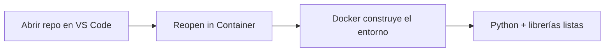

# Entorno de trabajo

El curso se puede seguir con **tres entornos**. Elige según la sesión y tus preferencias:

| Entorno | Cuándo | GPU | Configuración |
|---|---|---|---|
| **Google Colab** | Por defecto | ✅ gratis (T4) | Ninguna |
| **Entorno virtual local** (`venv`/`uv`) | Sesiones que no necesitan GPU | ❌ | 2 min |
| **DevContainer (VS Code)** | Flujo "de empresa" / reproducible | ⚠️ opcional | Docker + VS Code |

> El **mismo código** funciona en los tres: los notebooks son idénticos. Solo cambia dónde se ejecutan.

---

## 1 · Google Colab (por defecto)

Cada sesión tiene un notebook con el botón **"Abrir en Colab"**. Es la opción más rápida: GPU gratis y cero instalación.

- Activa la GPU: **Runtime → Change runtime type → T4 GPU** (solo la necesitas en fine-tuning y visión/audio).
- Instala librerías con `%pip install ...` en la primera celda.

## 2 · Entorno virtual local (`venv` / `uv`)

Para ejecutar el código en tu máquina (sesiones de CPU: tokenizadores, datasets, transformers, Gradio).

### Opción A · `venv` (clásico)

```bash
# 1. Crear el entorno (en la carpeta del repositorio)
python3 -m venv .venv

# 2. Activarlo
source .venv/bin/activate     # Linux / macOS
# .venv\Scripts\activate      # Windows (PowerShell)

# 3. Instalar las dependencias del curso
pip install -r course-requirements.txt
```

### Opción B · `uv` (moderno, más rápido — recomendado)

[`uv`](https://docs.astral.sh/uv/) es el gestor de entornos que está sustituyendo a `pip`/`venv`. Instálalo una vez y crea entornos en segundos:

```bash
# Instalar uv (Linux/macOS)
curl -LsSf https://astral.sh/uv/install.sh | sh
# Windows: winget install astral-sh.uv

# Crear el entorno y activarlo
uv venv
source .venv/bin/activate     # .venv\Scripts\activate en Windows

# Instalar dependencias (mucho más rápido que pip)
uv pip install -r course-requirements.txt
```

!!! tip "Comprobar que funciona"
    Tras activar el entorno, ejecuta `python` y prueba:
    ```python
    from transformers import pipeline
    print(pipeline("sentiment-analysis")("Me encanta este curso"))
    ```

## 3 · DevContainer en VS Code (flujo de empresa)

Un **DevContainer** es un contenedor Docker con todo el entorno preconfigurado. Todo el mundo trabaja en el **mismo entorno**, reproducible y aislado. Es lo que usan los equipos de ingeniería ML.

### Requisitos (una sola vez)

1. Instala [Docker Desktop](https://www.docker.com/products/docker-desktop/).
2. Instala [VS Code](https://code.visualstudio.com/) y la extensión **"Dev Containers"** (`ms-vscode-remote.remote-containers`).

### Usarlo

1. Clona el repositorio y ábrelo en VS Code.
2. VS Code detecta el fichero `.devcontainer/devcontainer.json` y sugiere **"Reopen in Container"**.
3. Pulsa el botón. Se construye el contenedor y **se instalan las dependencias automáticamente** (de `course-requirements.txt`).
4. Ya tienes Python + las librerías + Jupyter listos, sin tocar tu sistema.



### ¿Y la GPU?

El contenedor por defecto usa **CPU** (suficiente para casi todo el curso). Para GPU en local haría falta una imagen con CUDA y el *NVIDIA Container Toolkit*, más complejo. Por eso las sesiones pesadas (fine-tuning, visión) se hacen en **Colab**, y el DevContainer queda para las de CPU.

---

## ¿Cuál uso en cada sesión?

| Sesión | Colab | `venv`/`uv` | DevContainer |
|---|---|:---:|:---:|
| S28 · Ecosistema y pipelines | ✅ GPU | ✅ | ✅ |
| S31 · Tokenizadores | ✅ | ✅ (recomendado) | ✅ |
| S33 · Transformers | ✅ | ✅ | ✅ |
| S36 · Datasets | ✅ | ✅ (recomendado) | ✅ |
| S38 · Fine-tuning | ✅ (GPU) | ⚠️ lento | ⚠️ sin GPU |
| S41 · Visión/audio | ✅ (GPU) | ⚠️ lento | ⚠️ sin GPU |
| S44 · Despliegue Gradio | ✅ | ✅ (recomendado) | ✅ |

> **Regla práctica:** GPU → Colab · CPU y práctica de entorno → `venv`/`uv` o DevContainer.
