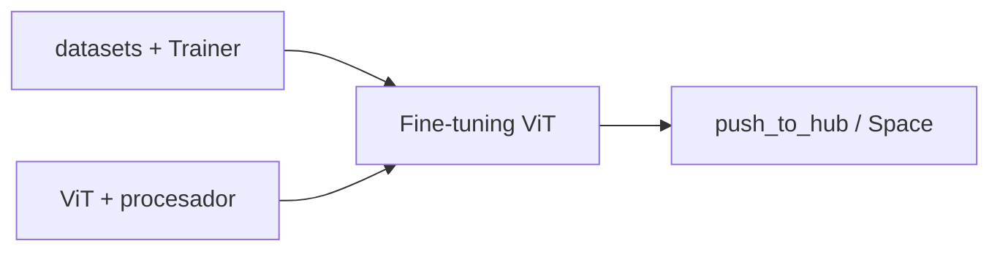

# Proyecto integrador · Fine-tuning de un Vision Transformer

> Actividad práctica que une las sesiones **S4** (datasets + `Trainer`), **S6** (visión) y **S7** (publicar en el Hub): afinar un **Vision Transformer (ViT)** para clasificar imágenes propias y publicarlo.

## Objetivo

Entrenar un modelo de **clasificación de imágenes** a partir de un dataset (propio o del Hub), evaluarlo y **publicarlo en el Hugging Face Hub**.

## Por qué une tres sesiones

- **S4:** `load_dataset`, preprocesado, `Trainer`, métricas.
- **S6:** `ViTForImageClassification` + `ViTImageProcessor`.
- **S7:** `push_to_hub` y (opcional) demo con Gradio.

## Pasos

1. **Elige un dataset** de imágenes: del Hub (p. ej. `food101`) o propio (carpeta con `imagefolder`).
2. **Carga y divide** con `load_dataset` + `train_test_split`.
3. **Preprocesa** con `ViTImageProcessor` y `with_transform`.
4. **Ajusta** `ViTForImageClassification` con `Trainer`.
5. **Evalúa** con `accuracy`/`F1`.
6. **Publica** el modelo con `push_to_hub` (token de escritura).

## Cuaderno

[Abrir en Colab](https://colab.research.google.com/github/jmperez-profesor/hf/blob/main/docs/recursos/proyecto_vision.ipynb){ .md-button } · [ver en el sitio](proyecto_vision.ipynb)

## Entregable

- Notebook `proyecto_vision.ipynb` ejecutado.
- Modelo publicado en el Hub (con su *model card*).

## Criterios de evaluación

| Criterio | Puntos |
|---|---|
| Dataset cargado y dividido correctamente | 2 |
| Preprocesado con `ViTImageProcessor` | 2 |
| Fine-tuning con `Trainer` funciona | 3 |
| Métricas computadas e interpretadas | 2 |
| Modelo publicado en el Hub | 1 |

## Vídeo de apoyo

- [Afinación del Vision Transformer](https://www.youtube.com/watch?v=cbb6Z2VOU9Q) — Codificando Bits, ~50 min — crea el dataset, monta el `Trainer` y afina un ViT con datos propios.

> Ampliación: despliega el modelo afinado en un **Space con Gradio** (ver S7) para cerrar el ciclo completo.
