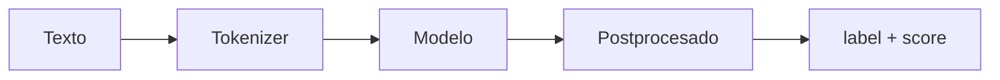

# Sesión 1 · El ecosistema y los pipelines (18/11/2026)

> **Objetivo:** resolver tareas reales con una línea de código y saber elegir un modelo en el Hub.
>
> Formato: ~30 min de explicación · ~75 min de notebook guiado · ~15 min de reto.

## Qué vas a aprender

| # | Al terminar la sesión serás capaz de… |
|---|---|
| 1 | Describir las piezas del ecosistema Hugging Face (Hub, `transformers`, `datasets`, `tokenizers`, `evaluate`) |
| 2 | Leer una *model card* (tarea, idioma, licencia, métricas, limitaciones) |
| 3 | Usar `pipeline()` para clasificación, NER, resumen, traducción, zero-shot y generación |
| 4 | Distinguir CPU/GPU y manejar la caché y el token de autenticación |

## Cuaderno de la sesión

[Abrir en Colab](https://colab.research.google.com/github/jmperez-profesor/hf/blob/main/docs/sesiones/sesion01_ecosistema_pipelines.ipynb){ .md-button } · [ver en el sitio](sesion01_ecosistema_pipelines.ipynb)

## 1 · El ecosistema Hugging Face

HF no es una librería, es un **ecosistema**:

| Pieza | Qué resuelve |
|---|---|
| **🤗 Hub** | Catálogo de modelos, datasets y Spaces (compartir/versionar) |
| **`transformers`** | Descargar y usar modelos (inferencia y fine-tuning) |
| **`datasets`** | Cargar y preparar datos |
| **`tokenizers`** | Convertir texto en números |
| **`evaluate`** | Métricas estandarizadas |

La idea central: **no entrenas desde cero, reutilizas** (*transfer learning*).

## 2 · Leer una model card

Una *model card* documenta el modelo: **tarea, idioma, licencia, tamaño, métricas y limitaciones**. Es tu contrato antes de usarlo. Filtrar en el Hub por tarea/idioma/licencia es la mitad del trabajo.

## 3 · `pipeline()`: una tarea en una línea

```python
from transformers import pipeline

clasificador = pipeline("sentiment-analysis")
print(clasificador("Me ha encantado el producto"))
# [{'label': 'POSITIVE', 'score': 0.99...}]
```



Tareas con la misma interfaz: `"sentiment-analysis"`, `"ner"`, `"summarization"`, `"translation"`, `"zero-shot-classification"`, `"text-generation"`.

## 4 · Elegir modelo, CPU/GPU, caché y token

- **Elegir modelo:** `pipeline("tarea", model="usuario/modelo")`. El por defecto es genérico y en inglés.
- **CPU/GPU:** `pipeline(..., device=0)` fuerza GPU; en Colab cambia a T4 en *Runtime*.
- **Caché:** los modelos se descargan una vez y se cachean en `~/.cache/huggingface`.
- **Token:** necesario para modelos privados o *gated* (`huggingface-cli login`).

## 5 · Cuenta, CLI y token de acceso

Para usar el Hub desde el terminal se instala `huggingface_hub`, que expone el comando **`hf`** (antes `huggingface-cli`):

```bash
pip install huggingface_hub
hf auth login          # pide un token de acceso
hf auth whoami         # confirma el usuario autenticado
hf cache scan          # cuánto ocupan los modelos descargados
```

El **token** puede ser de **lectura** (descargar/inferir) o de **escritura** (publicar modelos y datasets). Se genera en *Settings → Access Tokens* del Hub.

## 6 · Spaces e Inference API (adelanto)

- Un **Space** es una app (Gradio/Streamlit) servida como web pública para probar un modelo. Lo vemos en profundidad en la **sesión 7**.
- La **Inference API** permite probar un modelo desde la propia model card (widget) o por HTTP, sin descargarlo.

## Práctica (notebook)

Compara **dos modelos de sentimiento** (uno multilingüe y uno en español) sobre 20 frases propias y comenta las diferencias.

## Reto

Encuentra en el Hub el **mejor modelo para una tarea dada** (p. ej. NER en español) y **justifícalo con su model card**.

## Ejercicios de autoevaluación

**1.** Nombra las piezas del ecosistema HF y qué resuelve cada una.

??? tip "Solución"
    **Hub** (catálogo) · **transformers** (usar modelos) · **datasets** (datos) · **tokenizers** (texto→números) · **evaluate** (métricas).

**2.** ¿Qué campos clave debes mirar en una model card?

??? tip "Solución"
    Tarea, idioma, licencia, tamaño, métricas y limitaciones.

**3.** ¿Qué devuelve una `pipeline` de sentimiento y qué significa cada campo?

??? tip "Solución"
    `label` (etiqueta predicha) y `score` (confianza relativa 0–1, **no** una probabilidad calibrada).

**4.** ¿Por qué no conviene usar el modelo por defecto de `pipeline`?

??? tip "Solución"
    Es genérico y suele estar en inglés; para tu dominio/idioma conviene un modelo afinado.

## Observaciones

- `%pip install transformers` en el Colab.
- Primera descarga de un modelo puede tardar; la caché lo acelera después.

## Fuentes y atribución

- Documentación oficial: https://huggingface.co/docs
- Apartados de plataforma (CLI, token, Spaces) adaptados de **Aitor Medrano** (CC BY-NC-SA 4.0): https://aitor-medrano.github.io/iabd/hf/hf.html
