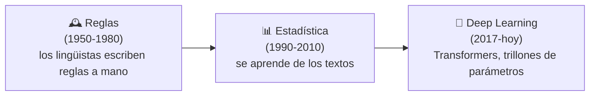
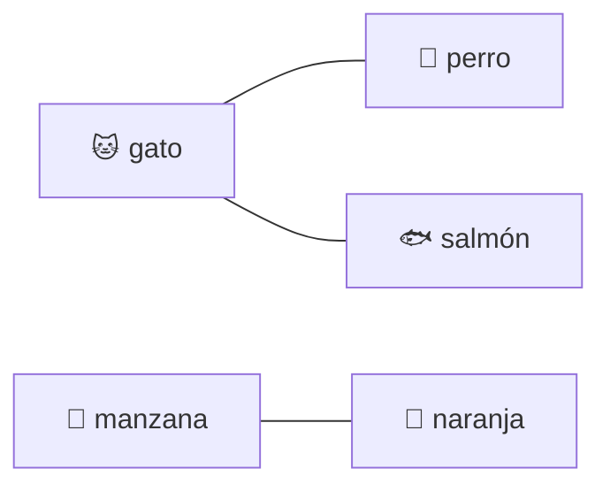
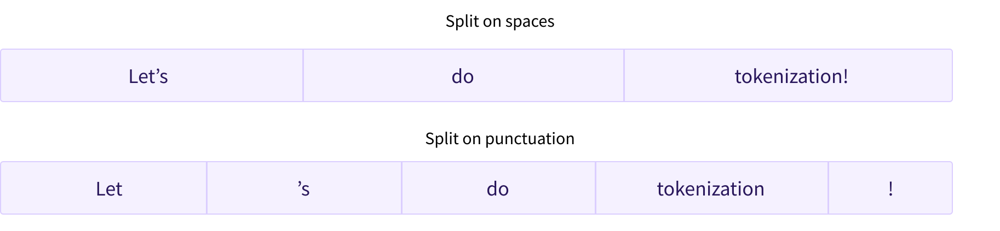
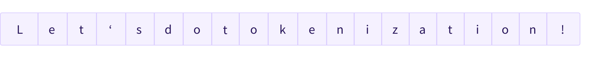
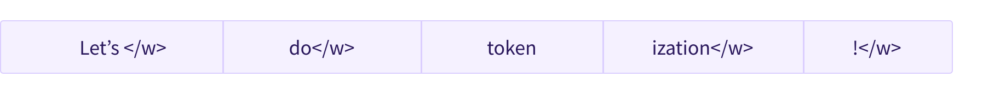
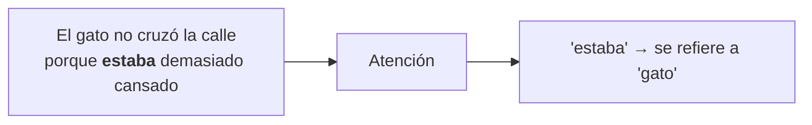
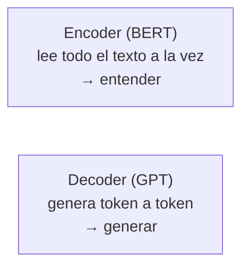
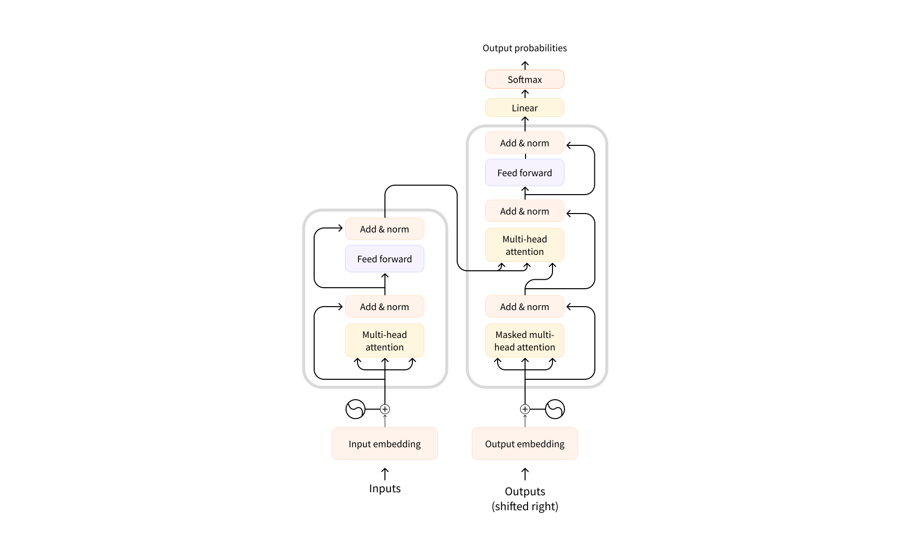
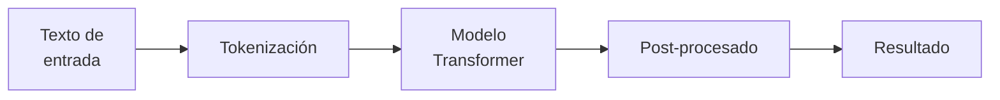
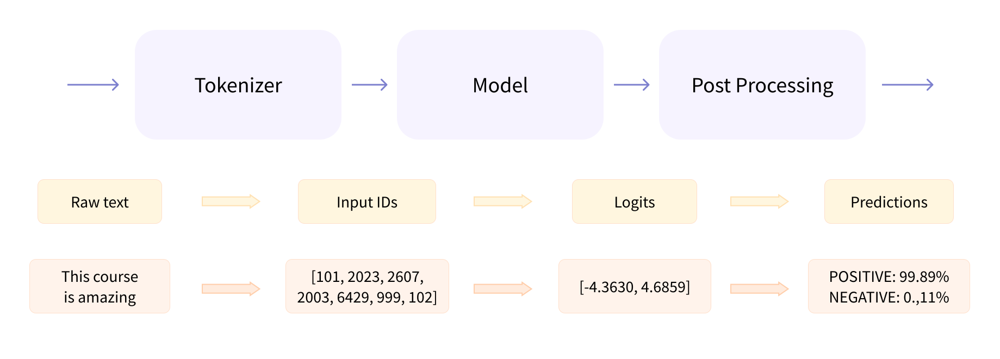

# Sesiones 29 y 31 · Introducción a la plataforma Hugging Face (18 y 23/11/2026)

> Sesiones introductorias que combinan **Procesamiento del Lenguaje Natural (PLN)**, la **arquitectura Transformer** y **Hugging Face**. Todo el código está listo para copiar en Colab o en local.

---

# Parte 1 · Procesamiento del Lenguaje Natural (PLN)

## 1.1 · El objetivo

El **PLN** (o *NLP*, Natural Language Processing) busca que una máquina **interprete y produzca** nuestro idioma con la misma comprensión que un humano. No es una tarea cualquiera: el lenguaje es ambiguo, depende del contexto y está lleno de matices.

## 1.2 · La historia: del optimismo a la humildad

Todo empezó de forma rudimentaria. El **experimento de Georgetown (1954)** —el primero de traducción automática— consiguió traducir **60 frases** del ruso al inglés, con un vocabulario de **250 palabras** y **6 reglas** gramaticales, sobre el ordenador **IBM 701**.

El resultado pareció milagroso, pero generó un **optimismo engañoso**: se creyó que el lenguaje humano, lleno de ambigüedad, podía encerrarse en un conjunto estricto de reglas manuales. No era así.

## 1.3 · Las tres eras del PLN



| Era | Enfoque | Límite / avance |
|---|---|---|
| **Reglas** (1950-80) | Simbólico: cada regla escrita a mano | El lenguaje es demasiado ambiguo para reglas fijas |
| **Estadística** (1990-2010) | Probabilidad: qué palabras suelen ir juntas | Traductores modernos y correctores |
| **Deep Learning** (2017-hoy) | Transformer + atención, aprendiendo de datos | De 250 palabras a **175.000 millones de parámetros** |

La idea clave del giro: **en lugar de decirle a la máquina cómo hablamos (reglas), construimos sistemas que descubren cómo hablamos a través de los datos**.

## 1.4 · El gran enemigo: la ambigüedad

El lenguaje humano no es código. Una misma palabra o frase puede tener **múltiples interpretaciones**:

| Tipo | Ejemplo | ¿Qué pasa? |
|---|---|---|
| **Léxica** | *"Me quedé esperándote en el **banco**"* | ¿Asiento de parque o entidad financiera? |
| **Sintáctica** | *"Compro los libros **baratos**"* | ¿Compro solo los baratos, o resultan baratos? |
| **Semántica** | *"Quiere pelearse con **un** italiano"* | ¿Cualquier italiano o uno concreto? |
| **Pragmática** | *"Golpeó el armario con el bastón y **lo** rompió"* | ¿Qué se rompió: el armario o el bastón? |
| **Morfológica** | *"**No traje traje**"* | ¿El verbo "traer" o la prenda de vestir? |
| **Fonológica** | *"**es-conde**"* | ¿Esconder, el verbo "ser", o un título nobiliario? |

La máquina debe **desambiguar** cada frase, filtrando el caos capa por capa hasta llegar a la intención real.

## 1.5 · Las cuatro capas de comprensión

Para entender una simple frase, la máquina domina la lingüística en cuatro niveles:

| Capa | Nivel | Qué analiza |
|---|---|---|
| **Morfología** | Superficial | La forma de la palabra (género, número, derivación) |
| **Sintaxis** | Estructural | Las reglas y el orden (*"El niño llora"* = Determinante + Nombre + Verbo) |
| **Semántica** | Profundo | El significado real de las palabras y cómo se combinan |
| **Pragmática** | Abisal | El contexto y la situación, lo extra-lingüístico |

## 1.6 · Del texto a los números: embeddings y tokenización

Para una máquina, **la semántica no es intuición, es geometría**. Las palabras se convierten en **coordenadas (vectores)** en un espacio: cuanto más cerca están, más parecidas son.



*"Gato" y "perro" (mamíferos) están cerca; "manzana" y "naranja" (frutas) también, pero en otra zona del espacio. La distancia matemática revela el significado.*

El **proceso de conversión** de texto a números tiene dos pasos:

1. **Tokenización:** se divide el texto en unidades pequeñas llamadas **tokens**.
2. **Embedding:** cada token se convierte en un **vector numérico** con significado.

Hay tres formas de tokenizar (de peor a mejor):







- **Por palabras:** vocabulario enorme (500.000+ palabras en inglés).
- **Por caracteres:** vocabulario pequeño, pero poco significado por pieza.
- **Por subpalabras (BPE):** el equilibrio ideal: palabras frecuentes enteras, palabras raras partidas en piezas con sentido (`token` + `##ización`).

---

# Parte 2 · La arquitectura Transformer

## 2.1 · La atención: el cerebro del Transformer

Antes de 2017, los sistemas leían el texto **secuencialmente** (RNN/LSTM). El **Transformer** (*Attention is All You Need*, 2017) introdujo la **atención**: cada palabra "mira" a las demás para deducir su contexto, sin importar la distancia.



> *"El gato no cruzó la calle porque estaba demasiado cansado."* El modelo aprende que **"estaba"** se refiere a **"gato"** (y que "gato" está cansado), aunque las palabras no estén juntas.

La atención funciona como un **radar espacial**: analiza toda la secuencia a la vez y asigna **pesos** a las palabras circundantes para deducir el contexto exacto (*"El banco estaba cerrado, así que me senté en él"* → *banco* = asiento).

## 2.2 · Anatomía técnica: QKV (Query, Key, Value)

El mecanismo de atención usa tres vectores por palabra:

| Vector | Pregunta que responde |
|---|---|
| **Query (consulta)** | ¿Qué está buscando la palabra actual? (*¿Hay algo que explique qué tipo de "banco" soy?*) |
| **Key (clave)** | ¿Qué etiqueta ofrecen las demás palabras? (*El verbo "sentar" ofrece: contexto físico*) |
| **Value (valor)** | La coincidencia: la palabra original **absorbe el valor** de sus vecinas para enriquecer su representación |

La **gravedad contextual** ajusta el significado matemático de cada palabra según sus vecinas. En 1954 esto requería 3 reglas manuales distintas para "planta" (vegetal / piso / instalación industrial); hoy el modelo lo resuelve por **gravedad estadística**.

## 2.3 · Atención multi-cabeza (*multi-head*)

¿Cómo mantiene el modelo el hilo lógico en textos largos? **Procesando en paralelo** con varias **cabezas de atención**, cada una vigilando un aspecto distinto:

- **Capa 1:** gramática.
- **Capa 2:** entidades (si mencionas a Juan en la página 1, una cabeza lo rastrea hasta la página 5).
- **Capa 3:** tema general.

## 2.4 · La ventana de contexto

La **ventana de contexto** es el límite físico de "memoria a corto plazo" del modelo: la cantidad máxima de información que puede ver a la vez. Si el texto la supera, el modelo **olvida lo más antiguo**.

| Modelo | Ventana de contexto |
|---|---|
| Georgetown (1954) | 1 frase |
| Modelos tempranos | párrafos |
| GPT-4o / Turbo | 128.000 tokens (~300 páginas) |
| Claude 3.5/3.7 | 200.000 tokens (~500 páginas) |
| GPT-5.2 (2026) | 400.000 tokens (~1.000 páginas) |
| Claude 4.6 (2026) | **1.000.000 tokens** (~2.500 páginas, varios libros) |

## 2.5 · BERT y GPT: encoder y decoder





| Familia | Ejemplo | Para qué |
|---|---|---|
| **Encoder** | BERT | Entender: clasificar, NER, embeddings |
| **Decoder** | GPT | Generar texto |
| **Encoder-decoder** | T5, BART | Transformar: traducción, resumen |

---

# Parte 3 · Hugging Face

## 3.1 · Qué es Hugging Face

Hugging Face es la **plataforma por excelencia de modelos y datasets**. Se fundó en 2016 (inicialmente un chatbot) y a partir de 2018 abrió a la comunidad sus modelos NLP. Hoy facilita el **descubrimiento, distribución, uso y fine-tuning** de modelos pre-entrenados.

El **Hub** funciona como un repositorio Git con:

| Sección | Qué contiene |
|---|---|
| **Models** | Modelos de NLP, visión y audio (400.000+) |
| **Datasets** | Conjuntos de datos (100.000+) |
| **Spaces** | Aplicaciones interactivas para probar modelos (150.000+) |

Sus librerías principales: **`transformers`** (texto) y **`diffusers`** (imágenes).

## 3.2 · `pipeline()`: un modelo en una línea

Un **pipeline** es una abstracción que encapsula todos los pasos para usar un modelo pre-entrenado:





Internamente hace tres pasos: **preprocesar** (convertir la entrada al formato del modelo) → **inferir** (pasar por el modelo) → **postprocesar** (convertir la salida en algo legible).

## 3.3 · Ejemplos listos para usar

### Análisis de sentimiento

```python
# pip install transformers
from transformers import pipeline

clasificador = pipeline("sentiment-analysis")

frases = [
    "Me encanta este producto, llegó antes de tiempo.",
    "Pésima calidad, se rompió al segundo día.",
    "Ni bien ni mal, simplemente normal.",
]

for frase in frases:
    r = clasificador(frase)[0]
    print(f"{frase}\n  → {r['label']} ({r['score']:.2f})\n")
```

### Traducción inglés → español

```python
from transformers import pipeline

frase_en = "I like to play basketball and being a geek"

traductor = pipeline("translation", model="Helsinki-NLP/opus-mt-en-es")
print(traductor(frase_en)[0]["translation_text"])
# Me gusta jugar al baloncesto y ser un friki
```

> ⚠️ La tarea `translation` se **eliminó en transformers v5**. Si usas v5, ver la [migración](../recursos/migracion_v5.md).

### Generación de imágenes (Stable Diffusion)

```python
# pip install diffusers torch transformers
from diffusers import DiffusionPipeline
import torch

# Con GPU: torch_dtype=torch.float16 + .to("cuda")
# Sin GPU: torch_dtype=torch.float32 (más lento)
pipeline = DiffusionPipeline.from_pretrained("sd-legacy/stable-diffusion-v1-5", torch_dtype=torch.float32)

imagen = pipeline("Una ardilla al estilo Picasso").images[0]
imagen.save("hola-hf.png")
```

## 3.4 · ¿Por qué v4 hoy y v5 después?

Un apunte importante antes de los ejercicios: **hoy usamos `transformers` v4 y en las próximas sesiones pasaremos a la v5**. Te lo explicamos en dos minutos.

**Qué pasó:** a finales de 2025, `transformers` sacó la versión 5 y **eliminó algunas funciones "de una línea"** (traducción, resumen, pregunta-respuesta). ¿Por qué? Porque un **modelo de lenguaje moderno (LLM)** hace esas tareas mejor, con solo darle una instrucción.

**La diferencia, en una línea:**

```python
# v4 (hoy): una función especializada, sin GPU
pipeline("translation", model="Helsinki-NLP/opus-mt-en-es")

# v5 (después): un LLM + un prompt (necesita GPU)
pipeline("text-generation", model="Qwen/...")
```

**¿Por qué empezamos con v4?** Porque es más sencilla: una línea, funciona en CPU y nos deja centrarnos en **qué es un pipeline, un modelo y un tokenizador**, sin la fricción de la v5.

> 🚗 **Analogía:** es como aprender a conducir — primero en un coche sencillo (v4) y, cuando dominas lo básico, te subes al coche real (v5). Los conceptos son los mismos; solo cambian nombres de funciones.

**¿Cuándo pasamos a v5?** En las próximas sesiones, cuando veamos los **LLM** (RAG, modelos en local), que es donde la v5 brilla.

!!! warning "Importante para los ejercicios"
    Al crear el entorno virtual, instala la **versión 4** (`pip install "transformers<5"`), porque el ejemplo del traductor usa una función que la v5 eliminó. Si instalas la última versión, ese ejemplo dará error.

    El detalle de qué cambió está en [Migración v4 → v5](../recursos/migracion_v5.md).

## 3.5 · El Hub: cuenta, CLI y token

Para interactuar con el Hub:

```bash
pip install huggingface_hub
hf auth login          # pide un token de acceso
hf auth whoami         # confirma el usuario autenticado
hf cache scan          # cuánto ocupan los modelos descargados
```

El **token** puede ser de **lectura** (descargar/inferir) o de **escritura** (publicar modelos y datasets).

---

# Ejercicios (sesiones 29 y 31)

## Actividad 1 · Traductor + Stable Diffusion (3p)

Crea un entorno virtual e instala las librerías necesarias para ejecutar el **traductor** (`transformers`) y el modelo **Stable Diffusion** (`diffusers`). Genera un par de frases e imágenes, anota en comentarios el **tiempo de generación** y adjunta las traducciones y las imágenes generadas.

## Actividad 2 · Cuenta, CLI y caché (1p)

Crea una cuenta en Hugging Face, instala el CLI, haz login (`hf auth login`) y averigua cuánto ocupan los modelos descargados (`hf cache scan`).

---

## Profundización

Esta sesión introductoria se profundiza en la [**S34 · Transformers, pipelines y tokenizadores**](sesion34_transformers.md), donde vemos el tokenizador, la atención y las familias del Transformer en detalle.
