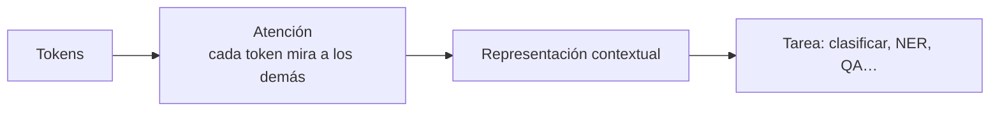
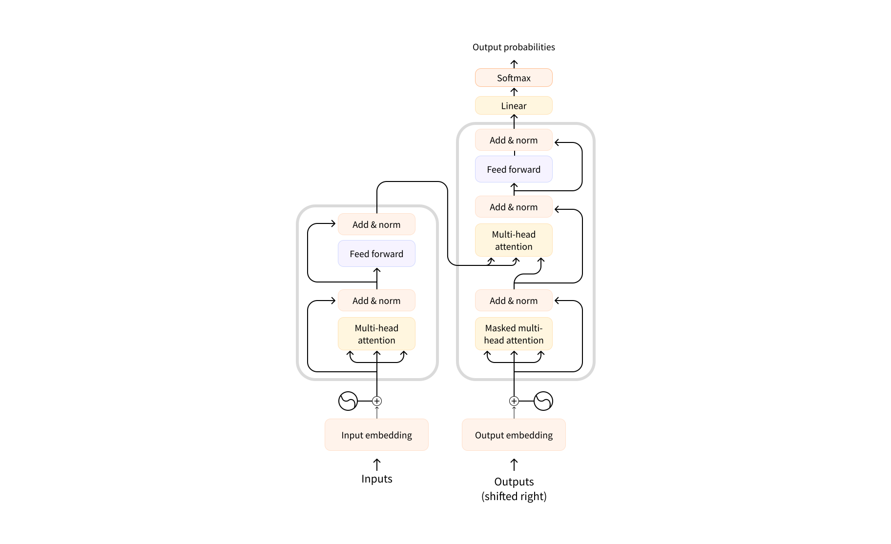

# Sesión 33 · Transformers por dentro (25/11/2026)

> **Objetivo:** abrir el pipeline y controlar cada paso a mano.
>
> Formato: ~30 min de explicación · ~75 min de notebook guiado · ~15 min de reto.

## Qué vas a aprender

| # | Al terminar la sesión serás capaz de… |
|---|---|
| 1 | Explicar la **intuición de la atención** y del bloque Transformer |
| 2 | Distinguir las tres familias: **encoder** (BERT), **decoder** (GPT) y **encoder-decoder** (T5) |
| 3 | Diferenciar `AutoModel` de `AutoModelForXxx` (cuerpo + cabeza de tarea) |
| 4 | Convertir **logits → probabilidades** y leer `id2label` |
| 5 | Generar *embeddings* de frase con sentence-transformers |

## Cuaderno de la sesión

[Abrir en Colab](https://colab.research.google.com/github/jmperez-profesor/hf/blob/main/docs/sesiones/sesion33_transformers.ipynb){ .md-button } · [ver en el sitio](sesion33_transformers.ipynb)

## 1 · Intuición de la atención

Antes de 2017 se leía el texto **secuencialmente** (RNN/LSTM). El **Transformer** (*Attention is All You Need*) introduce la **atención**: cada token se representa **teniendo en cuenta todos los demás** de la frase, en paralelo.





Resultado: capta mejor el contexto (desambiguar) y entrena mucho más rápido. *(Solo la intuición, sin matemática.)*

## 2 · Las tres familias

| Familia | Ejemplo | Para qué |
|---|---|---|
| **Encoder** (lee todo el texto a la vez) | BERT, RoBERTa | Entender: clasificar, NER, embeddings |
| **Decoder** (genera token a token) | GPT, Llama | Generar texto |
| **Encoder-decoder** | T5, BART | Transformar: traducción, resumen |

## 3 · `AutoModel` frente a `AutoModelForXxx`

- `AutoModel` → el **cuerpo** (representaciones), sin tarea concreta.
- `AutoModelForSequenceClassification`, `AutoModelForQuestionAnswering`… → cuerpo **+ cabeza** para una tarea.

```python
from transformers import AutoModelForSequenceClassification
modelo = AutoModelForSequenceClassification.from_pretrained("distilbert-base-uncased", num_labels=2)
```

## 4 · De logits a probabilidades

El modelo devuelve **logits** (puntuaciones). El **softmax** los convierte en probabilidades que suman 1:

```python
import torch
logits = torch.tensor([2.0, 0.5])          # clase 0 vs clase 1
probs = torch.softmax(logits, dim=-1)      # -> [0.82, 0.18]
pred = int(torch.argmax(probs))            # -> 0
print(modelo.config.id2label[pred])        # 'LABEL_0' (o el nombre real)
```

## 5 · Embeddings de frase y búsqueda semántica

sentence-transformers produce un **vector** por frase; frases parecidas → vectores cercanos:

```python
from sentence_transformers import SentenceTransformer
modelo = SentenceTransformer("all-MiniLM-L6-v2")
emb = modelo.encode(["¿Dónde está mi pedido?", "Estado de mi envío"])
```

## Práctica (notebook)

Reproduce **a mano** el resultado de un pipeline de clasificación: tokeniza → infiere → softmax → `argmax` → `id2label`.

## Reto

**Buscador semántico** sobre 100 preguntas frecuentes: codifica las FAQs, codifica una consulta y devuelve la más cercana por similitud coseno.

## Ejercicios de autoevaluación

**1.** ¿Qué aporta la atención frente a leer el texto secuencialmente?

??? tip "Solución"
    Contexto global (cada token considera todos los demás) y paralelismo → mejor desambiguación y entrenamiento más rápido.

**2.** ¿Para qué sirve cada familia (encoder / decoder / encoder-decoder)?

??? tip "Solución"
    Encoder para **entender** (clasificar, NER); decoder para **generar**; encoder-decoder para **transformar** (traducir, resumir).

**3.** ¿Qué diferencia hay entre `AutoModel` y `AutoModelForSequenceClassification`?

??? tip "Solución"
    `AutoModel` da el cuerpo (representaciones); `AutoModelForXxx` añade la **cabeza** de la tarea concreta.

**4.** ¿Qué son los logits y qué hace el softmax?

??? tip "Solución"
    Los logits son las puntuaciones por clase; el softmax los convierte en probabilidades que suman 1, y `argmax` elige la clase ganadora.

**5.** ¿Qué es un *embedding* de frase y para qué sirve?

??? tip "Solución"
    Un vector que representa el significado de la frase; permite **búsqueda semántica** (frases parecidas → vectores cercanos).

## 🎬 Vídeos de la sesión (serie DotCSV)

- [Parte 1 · De texto a vectores](https://www.youtube.com/watch?v=Tg1MjMIVArc) — 11 min — evolución del NLP.
- [Parte 2 · ¿Qué es un embedding?](https://www.youtube.com/watch?v=RkYuH_K7Fx4) — 15 min — vectorización del lenguaje.
- [Parte 3 · ¿Qué es un Transformer?](https://www.youtube.com/watch?v=aL-EmKuB078) — 18 min — atención, Query/Key/Value y *Attention Is All You Need* (la más valiosa).
- [Parte 4 · ¿Por qué estas redes son tan potentes?](https://www.youtube.com/watch?v=xi94v_jl26U) — 15 min — paralelización y positional encoding.

## Observaciones

- `%pip install transformers sentence-transformers` en el Colab.
- `all-MiniLM-L6-v2` es ligero y rápido en CPU.
