# Sesión 34 · Hub: Spaces, Modelos y Datasets (25/11/2026)

> Contenido reproducido con la autorización de **Aitor Medrano** (I.E.S. Severo Ochoa), de sus apuntes [Hugging Face](https://aitor-medrano.github.io/iabd/hf/hf.html) (CC BY-NC-SA 4.0). Texto, imágenes y enlaces copiados tal cual.

## Proyecto de la sesión · Crea un Space de traducción

> 🎯 **Actividad 3** (RAMIA.1 / CEMIA.1d, CEMIA.1e / 2p). Vamos a construir, paso a paso, un **Space de Gradio que traduce** (reutilizando el traductor de la sesión anterior), primero en Hugging Face y luego en local. Al final, lo completas con tu toque personal.

### Paso 1 · Crea el Space

1. Ve a tu perfil de Hugging Face → pestaña **Spaces** → **Create new Space**.
2. Configúralo: **nombre** (p. ej. `mi-traductor`), **licencia**, **SDK = Gradio**, **plantilla = Blank**, **hardware = CPU (gratis)** y **visibilidad = Público**.
3. Pulsa **Create Space**.

### Paso 2 · Escribe el `app.py`

Sustituye el contenido del fichero `app.py` por:

```python
import gradio as gr
from transformers import pipeline

traductor = pipeline("translation", model="Helsinki-NLP/opus-mt-en-es")

def traducir(texto):
    return traductor(texto)[0]["translation_text"]

demo = gr.Interface(
    fn=traducir,
    inputs=gr.Textbox(label="Inglés", placeholder="Escribe aquí..."),
    outputs="text",
    title="Traductor EN → ES",
    examples=["I like to play basketball"],
)
demo.launch()
```

> ⚠️ En `transformers` v5 la tarea `translation` se eliminó. Si usas v5, cambia el `pipeline` por `AutoModelForSeq2SeqLM` (ver [Migración v4 → v5](../recursos/migracion_v5.md)).

### Paso 3 · Publica y prueba

1. Haz **Commit** del `app.py` (el Space se reconstruye automáticamente).
2. Cuando termine, escribe una frase en inglés y verás la traducción.
3. ¡Ya tienes tu Space público! Cualquiera con la URL puede usarlo.

### Paso 4 · También en local

Prueba el mismo `app.py` en tu ordenador:

```bash
pip install gradio transformers
python3 app.py
```

Se abre en `http://127.0.0.1:7860`.

### Tu toque personal (completa la actividad)

Para que el Space sea **tuyo** (y no una copia del profesor), elige al menos una de estas mejoras:

- Cambia el **par de idiomas** (p. ej. ES → EN, u otro modelo de `Helsinki-NLP`).
- Añade **ejemplos** propios a la interfaz.
- Cambia el **título, descripción o tema** del Space.
- Añade un `requirements.txt` con las dependencias y una **descripción** en el README.

**Entregable:** la URL de tu Space + una captura de la app funcionando (en HF y en local).

---

## Spaces

Mediante los espacios podemos construir y desplegar modelos de IA, así como aplicaciones de demostración para probarlos.

Podemos crear *demos* de forma rápida, con una pocas líneas de *Python*, con las librerías [Gradio](https://www.gradio.app/) o [Streamlit](https://streamlit.io/), y utilizar controles multimodales que facilitan el testeo de los modelos.

Por ejemplo, si vamos a los espacios, podemos ordenarlos por los que tienen más *likes*, y entrar a [MusicGen](https://huggingface.co/spaces/facebook/MusicGen) y ver los diferentes controles para introducir texto, subir un archivo, así como posteriormente reproducir un audio o un vídeo:

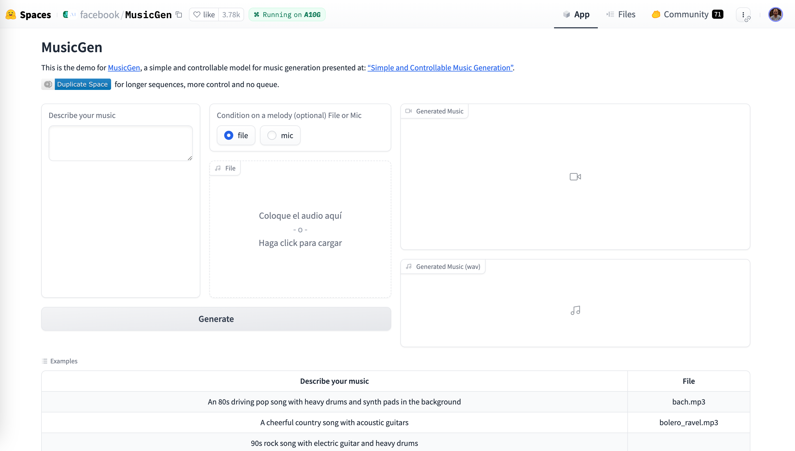

Otros espacios no tienen apariencia de formulario, como [FacePoke](https://huggingface.co/spaces/jbilcke-hf/FacePoke) (prueba a subir una foto de un retrato, o una versión menos interactiva como [expression-editor](https://huggingface.co/spaces/fffiloni/expression-editor)), o permiten el uso de la aplicación en tiempo real como [Realtime-whisper-large-v3-turbo](https://huggingface.co/spaces/KingNish/Realtime-whisper-large-v3-turbo), pudiendo ofrecer elementos de ejemplo para probar los modelos como [Kolors-Virtual-Try-On](https://huggingface.co/spaces/Kwai-Kolors/Kolors-Virtual-Try-On).

En este bloque, y en concreto en la próxima sesión nos vamos a centrar en *Gradio* para la creación del interfaz de usuario.

El uso básico de los espacios es gratuito, pero si necesitamos emplear GPU puede ser que necesitemos pagar por su uso.

### Hola Spaces

Para familiarizarnos con ellos, vamos a crear nuestro espacio que utilizaremos a lo largo del bloque. Para ello, dentro de la pestaña *Spaces*, creamos uno nuevo (*Create new Space*), y vemos como primero indicamos un nombre, una licencia, el SDK que utilizaremos para el prototipado, el hardware empleado y la visibilidad del mismo:

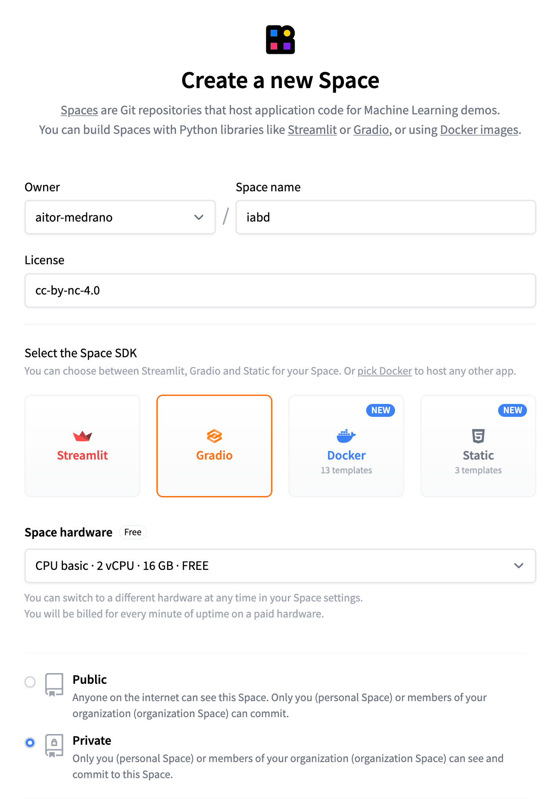

Si desplegamos sobre el tipo de *hardware*, podemos ver las diferentes opciones de tamaño y precio que ofrece la plataforma por hora de ejecución:

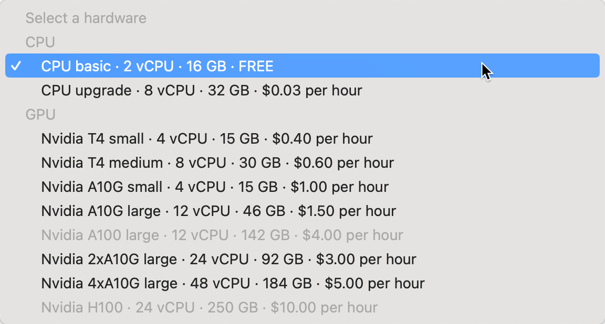

En nuestro caso, vamos a coger la instancia gratuita y elegiremos un proyecto *Gradio* con una plantilla en blanco (*blank*). Como podéis observar, además de *Streamlit*, podemos usar imágenes de *Docker* o utilizar plantillas estáticas. Finalmente, seleccionamos que queremos hacer nuestro espacio en abierto, para que sea accesible por cualquiera.

Tras ello, nos saldrá una página con información para clonar el repositorio creado:

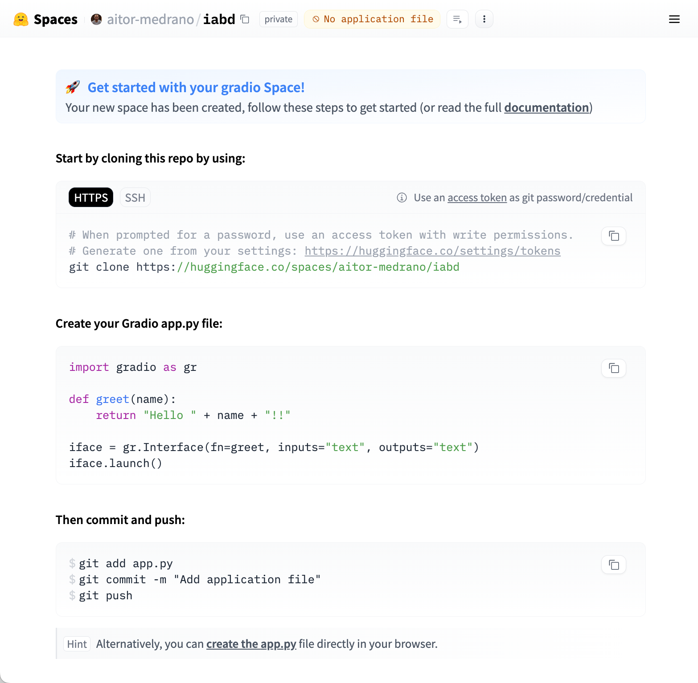

En nuestro caso, vamos a añadir la aplicación inicial desde el navegador pulsando sobre el enlace "*create the app.py*" y añadimos el siguiente fragmento que emplea *Gradio* y realizamos un *commit* desde el interfaz web:

`app.py`

```python
import gradio as gr

def saluda(nombre):
    return "Hola " + nombre + "!"

demo = gr.Interface(fn=saluda, inputs="text", outputs="text")
demo.launch(share=True)
```

Si ahora vamos nuestro perfil, podremos ver cómo se ha creado el espacio, y si pulsamos sobre él, aparecerá la aplicación:

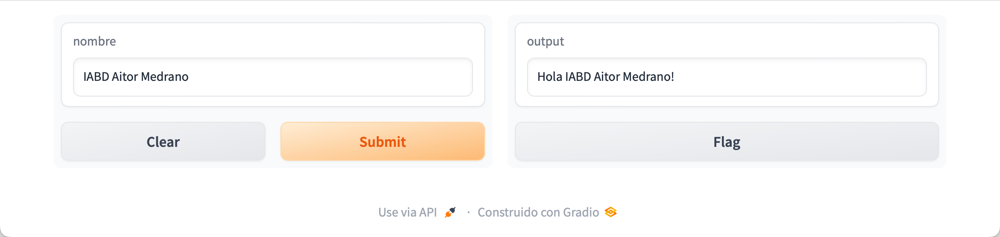

#### Probando en local

Para probar *Gradio* en local, el primer paso será instalar la librería:

```bash
pip install gradio
```

Y a continuación, lanzar el *script* pero en vez de con el intérprete de *Python*, con el comando `gradio`:

```bash
gradio app.py
```

¿Te aparece una dirección local y otra remota? ¿Dónde se está ejecutando el código de la URL remota?

### Hola Spaces 2.0

Vamos a reutilizar el ejemplo inicial de generar una imagen desde *Stable Difussion* para generar un prototipo que nos permita escribir el *prompt* y visualizar el resultado.

Para ello, desde la pestaña *Files*, añadimos un nuevo fichero con el código de nuestra aplicación que ahora llamaremos `stable-app.py` ahora será similar a:

`stable-app.py`

```python
import gradio as gr
from diffusers import DiffusionPipeline
import torch

def stable(prompt):
    pipeline = DiffusionPipeline.from_pretrained("sd-legacy/stable-diffusion-v1-5", torch_dtype=torch.float32)
    return pipeline(prompt).images[0]

demo = gr.Interface(fn=stable, inputs="text", outputs="image")
demo.launch()
```

Para indicarle al *Space* que este fichero es la nueva aplicación, editamos el fichero `README.md` que contiene la configuración del espacio (título, colores del banner, descripción y el nombre del *script* que lanza la aplicación):

`README.md`

```yaml
---
title: IABD
emoji: 🌍
colorFrom: blue
colorTo: indigo
sdk: gradio
sdk_version: 4.25.0
app_file: stable-app.py
pinned: false
license: cc-by-nc-4.0
short_description: Probando los Spaces en IABD
---
```

Algunos de los campos los podemos editar directamente desde el interfaz gráfico, pero también podemos editar directamente el archivo:


Si ahora volvemos a la pestaña de la aplicación veremos que ha fallado ¿El motivo? Claramente no hemos instalado ninguna de las librerías que necesita nuestro ejemplo. Por defecto, los *Spaces* ya tienen instaladas las librerías `huggingface_hub` para gestionar los repositorios y ficheros del Hub, `requests` para realizar llamadas a APIs externas, `datasets` para cargar y mostrar datos (la veremos en una próxima sesión) y el SDK seleccionado, ya sea `gradio` o `streamlit`.

Para instalar otras dependencias, añadiremos a la raíz un archivo nombrado `requirements.txt`:

`requirements.txt`

```text
diffusers
torch
transformers
accelerate
```

Tras hacer el *commit* del archivo, el espacio volverá a construirse. Y tras ello, ya podemos introducir nuestro *prompt* y tras más de 17 minutos (no utiliza GPU) podremos ver el resultado:


## Modelos

*Hugging Face* ofrece multitud de modelos que podemos probar y utilizar en nuestras aplicaciones. Además, si queremos, podemos utilizar alguna técnica de transferencia de conocimiento para crear nuestros propios modelos adaptados a nuestras necesidades.

Si entramos a la página de [Modelos](https://huggingface.co/models), podemos buscar un modelo por tarea o palabra clave, y ordenar los resultados por popularidad, tendencia o actualizaciones recientes.

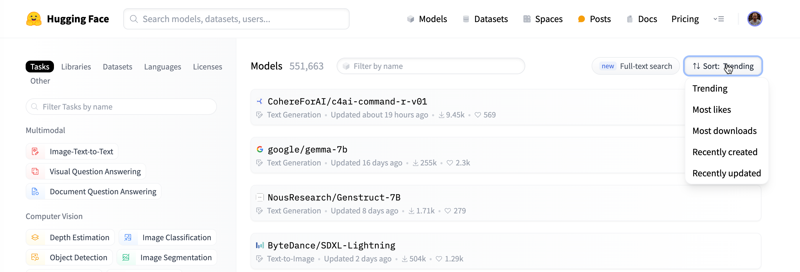

Si entramos a un modelo en concreto, por ejemplo a [speecht5_tts](https://huggingface.co/microsoft/speecht5_tts) o [opus-mt-en-es](https://huggingface.co/Helsinki-NLP/opus-mt-en-es), podemos ver una ficha con información del modelo como el método de entrenamiento, la licencia de uso, estadísticas de uso e interacciones de la comunidad, herramientas para utilizar el modelo (Inference API) o importarlo en nuestro propio código, así como qué espacios utilizan este modelo.


Por último, la página [tareas](https://huggingface.co/tasks) (*Tasks*) agrupa todos los modelos de IA por su utilidad:

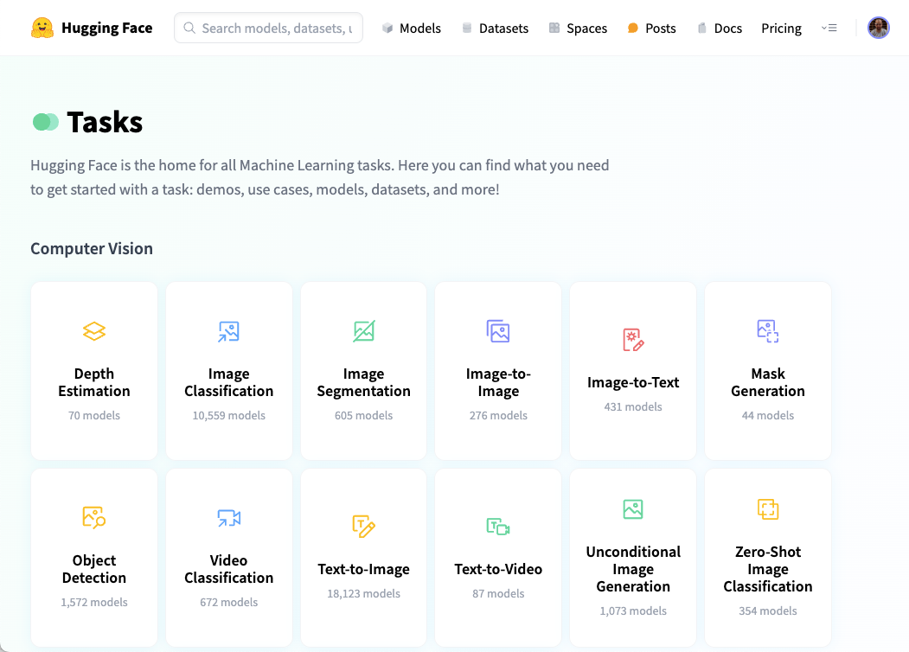

### Creando un modelo

El primer paso es crear un modelo que implícitamente inicializará un repositorio donde almacenar el código fuente y los artefactos.

Para crear el modelo, de forma similar a cómo hicimos al crear el espacio, vamos a nuestro perfil y pulsamos sobre `+ New Model` y tras ponerle un nombre y una licencia, accederemos a su panel donde tenemos por una parte una *card* que hace de página de inicio, la pestaña con los ficheros y versiones que hace de repositorio, así como la posibilidad de interactuar con la comunidad y las preferencias.

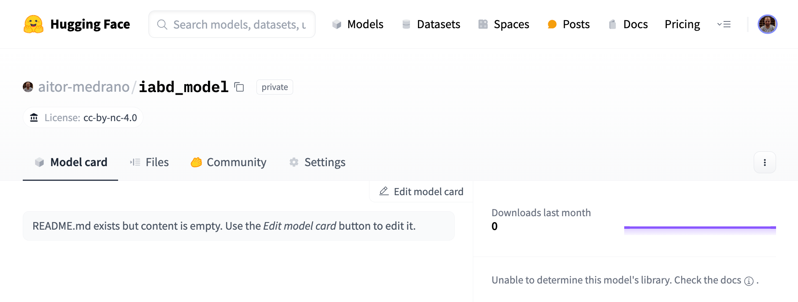

Vamos a ir a la pestaña de *Files and versions* y añadimos un archivo desde el interfaz web (`+Add file`), por ejemplo, lo nombramos `authors.txt` y ponemos nuestro nombre en el contenido:

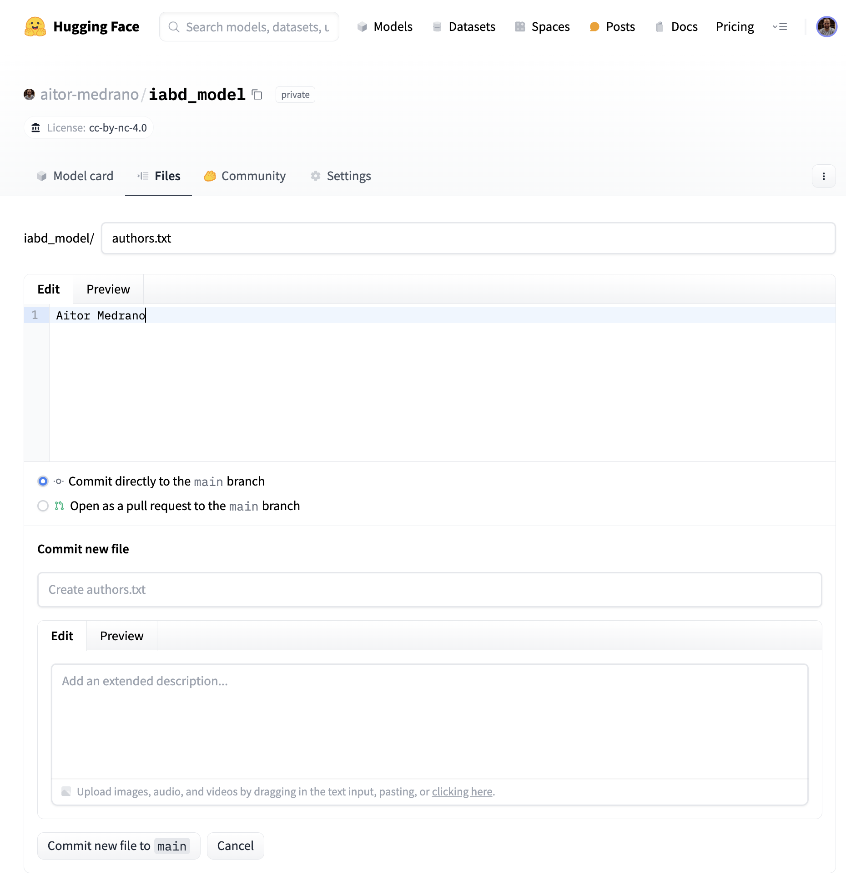

Y si ahora vamos a la pestaña de archivos, vemos como tenemos el archivo recién añadido, así como el archivo `README.md` que nos permite configurar la página de inicio de nuestro modelo:

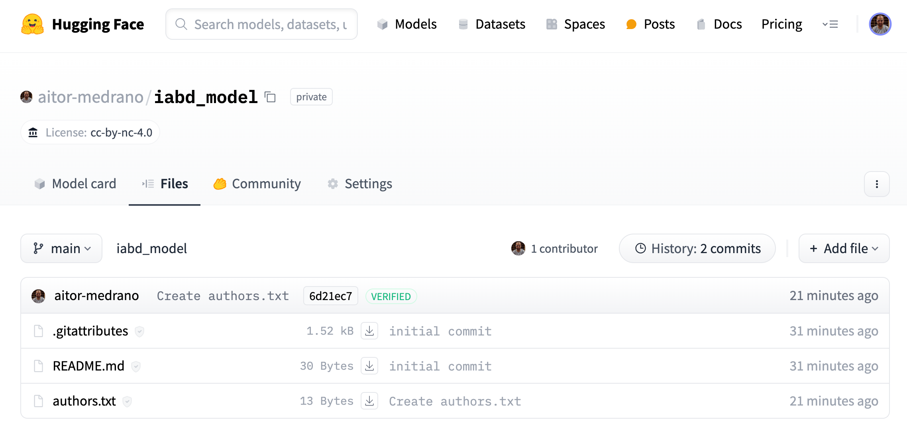

### Usando Git

Para poder trabajar con el repositorio ya hemos visto que podemos hacerlo mediante el interfaz web, aunque lo más cómodo para nosotros será trabajar mediante Git y GitLFS. [GitLFS](https://git-lfs.com/) es una extensión para trabajar con archivos de gran tamaño (superiores a 10Mb), ya que es posible, que bien nuestros modelos o bien nuestros *datasets* tengan un tamaño considerable.

Así pues, como es probable que trabajemos con archivos superiores a los 10Mb, instalaremos en nuestro sistema *git-lfs*:

```bash
sudo apt-get install git-lfs # Ubuntu
brew install git-lfs    # MacOS
```

#### Usando SSH

Para evitar tener que poner el usuario y contraseña al hacer *push*, es más cómodo generar una clave SSH y subirla a nuestro perfil.

Antes de [generar una clave](https://huggingface.co/docs/hub/en/security-git-ssh#generating-a-new-ssh-keypair), es posible que ya tengamos una generada en `~/.ssh` (*Linux/MacOS*) o en `C:\Users\<usuario>\.ssh` (*Windows*) con algún archivo similar a `id_rsa.pub`. Si no fuera el caso, sí que tenemos que generar una clave y añadirla al agente:

```bash
ssh-keygen
ssh-add ~/.ssh/id_rsa
```

A continuación, vamos a las preferencias del usuario, y en la opción *SSH and GPG Keys*, creamos una nueva clave, poniendo como identificador, por ejemplo, el nombre de nuestro ordenador, y en la clave, pegamos el contenido del archivo `.pub` generado anteriormente.

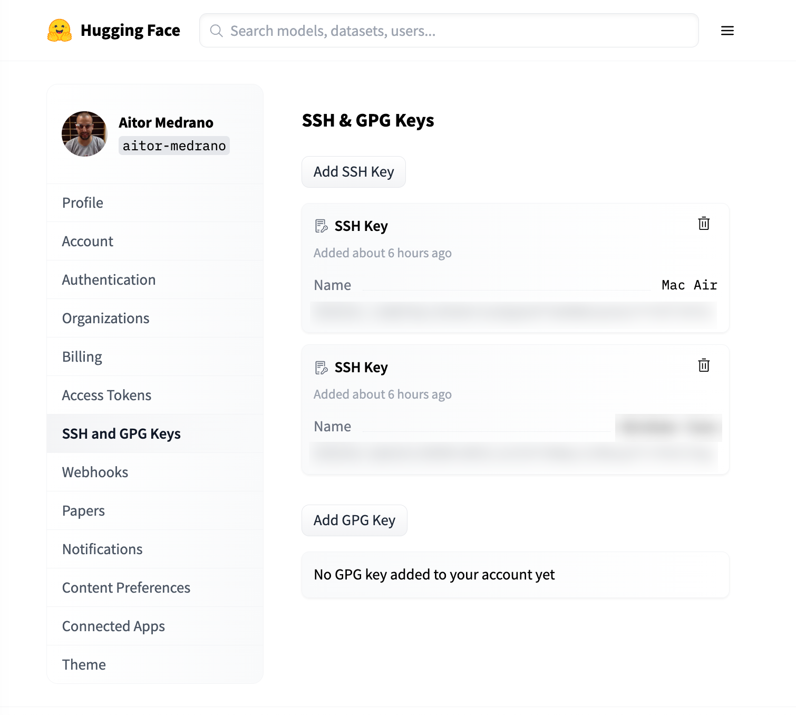

Y haciendo uso de git, clonamos el repositorio:

```bash
git clone git@hf.co:aitor-medrano/iabd_model
cd iabd_model
```

Y comprobamos como se han descargado los archivos del modelo, incluyendo el que hemos creado previamente:

```bash
% ls
README.md       authors.txt
```

Y habilitamos Git-LFS:

```bash
git lfs install
```

Si nuestros ficheros van a superar los 5GB, también deberemos habitarlos en *Hugging Face*:

```bash
huggingface-cli lfs-enable-largefiles .
```

Para seguir con este ejemplo, vamos a descargarnos los archivos del modelo [`omarques/autotrain-dogs-and-cats-1527055142`](https://huggingface.co/omarques/autotrain-dogs-and-cats-1527055142) (`config.json`, `preprocessor_config.json` y el modelo `pytorch_model.bin`) y pegarlos dentro de nuestra carpeta `iabd_model`. Tras ello, los subimos mediante Git al repositorio:

```bash
git add .
git commit -m "Primera version"
git push
```

Si ahora vamos a la página web, veremos cómo ya aparecen los mismos archivos y cómo el archivo `pytorch_model.bin` se ha marcado como LFS:


### Model Card

La [tarjeta del modelo](https://huggingface.co/docs/hub/model-cards) aporta información muy útil, como es la categoría de este, así como librerías, *datasets*, idiomas o los resultados obtenidos en la fase evaluación del modelo.

Si nos fijamos en la tarjeta del modelo de que hemos [escogido anteriormente](https://huggingface.co/omarques/autotrain-dogs-and-cats-1527055142), podemos ver toda la información mostrada, con las diferentes etiquetas (*Image Classification*, *Pytorch*, etc...), así como las estadísticas y el bloque para probar el modelo directamente:


Así pues, vamos a editar nuestra tarjeta, y añadiremos los siguientes elementos:

`README.md`

```yaml
tags:
- vision
- image-classification
datasets:
- omarques/autotrain-data-dogs-and-cats
```

De manera, que ahora nuestro modelo tendrá la siguiente apariencia:


En próximas sesiones donde nos centremos en el *fine-tuning*, volveremos a la tarjeta del modelo para anotar toda la información obtenida.

### Inference API

Si vamos a la tarjeta de nuestro modelo, si nuestro modelo tiene la suficiente visibilidad social (*likes*) veremos que en la parte derecha se ha marcado dentro del bloque de *Inference API* que se trata de un modelo de clasificación de imágenes y nos permite arrastrar una imagen.

Esta API utiliza un [widget](https://huggingface.co/docs/hub/en/models-widgets) el cual obtiene información de los metadatos del modelo y del archivo de configuración (`config.json`) para saber qué interfaz mostrar. Si queremos, podemos indicarlo de forma explícita mediante el `pipeline_tag` de la tarjeta del modelo, por ejemplo, en nuestro caso `image-classification`.

Por ejemplo, si le pasamos una [foto](../assets/images/aitor_perro-gato.jpg) al bloque, veremos cómo se carga el modelo y al finalizar, nos muestra la predicción que ha realizado categorizando la imagen:


#### Valores de ejemplo

Aunque a priori se pueden [añadir elementos](https://huggingface.co/docs/hub/models-widgets#how-can-i-control-my-models-widget-example-input) para probar el modelo directamente, actualmente no funciona, al menos, para poner imágenes de entrada.

### Actividad (opcional) · Publica un modelo de perros y gatos

Siguiendo la sección **Usando Git**, crea un modelo y configura tu clave SSH. Descarga los archivos del modelo [`omarques/autotrain-dogs-and-cats-1527055142`](https://huggingface.co/omarques/autotrain-dogs-and-cats-1527055142) (`config.json`, `preprocessor_config.json`, `pytorch_model.bin`), súbelos a tu modelo y, mediante Python, realiza la inferencia con un `pipeline` de `image-classification`.

*(Actividad 4 de Aitor Medrano: RAPIA.3 / CEPIA.3b, CEPIA.3c / opcional.)*

## Datasets

Por último, *Hugging Face* también ofrece un entorno para la utilización y publicación de *datasets*, organizados por categorías, tamaños, lenguajes y licencias de uso:

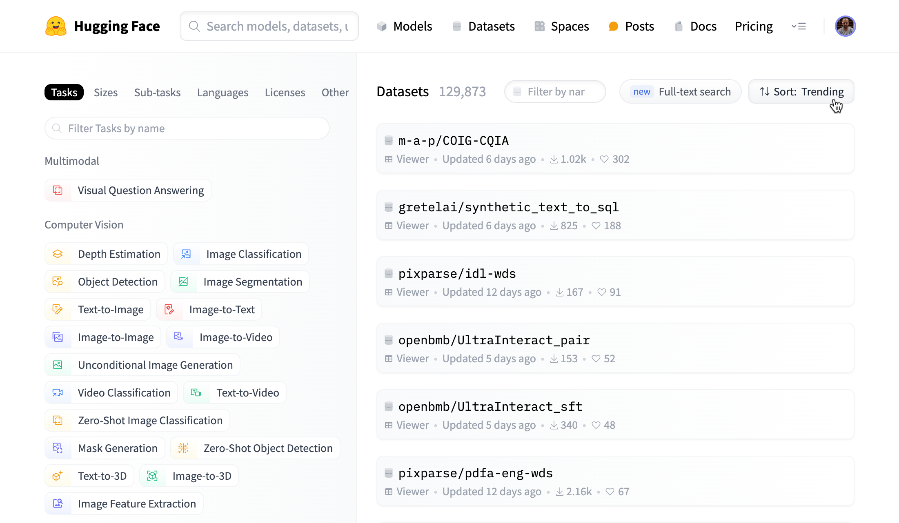

Por ejemplo, uno de los *datasets* más utilizados al estudiar redes neuronales es el [MNIST](https://huggingface.co/datasets/mnist) que contiene 70.000 imágenes de 28x28 en blanco y negro con los dígitos transcritos. Como podemos observar, el entorno ofrece previsualización de todas las columnas, así como la posibilidad de utilizar el *dataset* con unas pocas líneas de código:

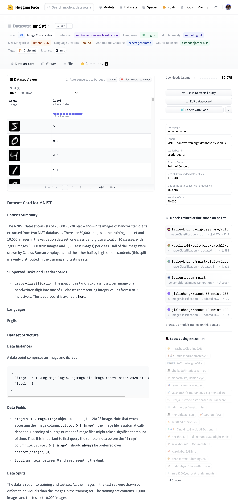

Si queremos usar el *dataset*, podemos pulsar sobre el botón *Use in Datasets library* o codificar el siguiente fragmento:

```python
from datasets import load_dataset

mnist_dataset = load_dataset("mnist")
print(mnist_dataset)
# DatasetDict({
#     train: Dataset({
#         features: ['image', 'label'],
#         num_rows: 60000
#     })
#     test: Dataset({
#         features: ['image', 'label'],
#         num_rows: 10000
#     })
# })
```

Y si queremos acceder a una imagen:


```python
imagen = mnist_dataset["train"]["image"][0]
etiqueta = mnist_dataset["train"]["label"][0]
print(etiqueta) # 5
```

Además, al abstraer los datos dentro de la librería *datasets*, se crea la estructura de datos necesaria para entrenar los modelos más fácilmente mediante la clase [`Trainer`](https://huggingface.co/docs/transformers/main/en/trainer) que facilita realizar el mismo proceso de *fine-tuning* a diferentes modelos (esto lo estudiaremos más adelante en la sesión sobre *fine-tuning*).

### Creando nuestro dataset

Aunque más adelante veremos cómo utilizar la librería *datasets* para cargar, filtrar y persistir *datasets*, vamos a ver cómo crear un *dataset* en *HuggingFace* para almacenar los datos. Para ello, el primer paso es crearlo desde el interfaz gráfico, y a continuación, podemos acceder a la pestaña de *Files* y subiremos, por ejemplo, los datos de [`cp_train.csv`](../assets/resources/cp_train.csv), [`cp_test.csv`](../assets/resources/cp_test.csv) y [`cp_val.csv`](../assets/resources/cp_val.csv):

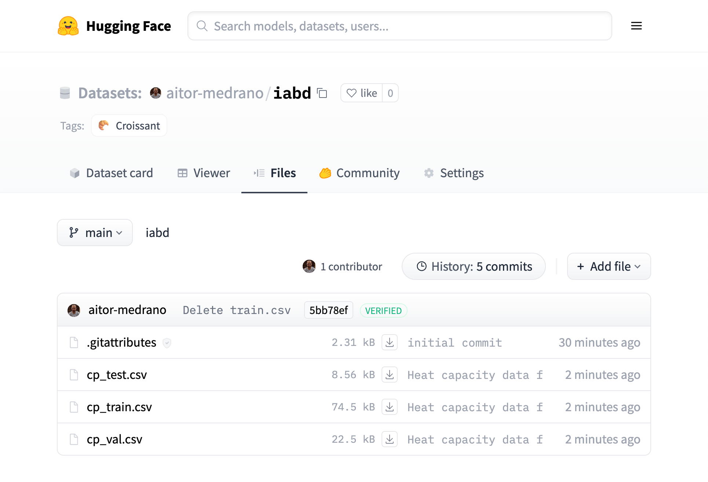

Una vez añadidos los archivos, automáticamente se mostrará la información (ya que los nombres de archivos contienen token reconocidos, como `test`, `train`, `val`...). Más información en [https://huggingface.co/docs/datasets/repository_structure](https://huggingface.co/docs/datasets/repository_structure):

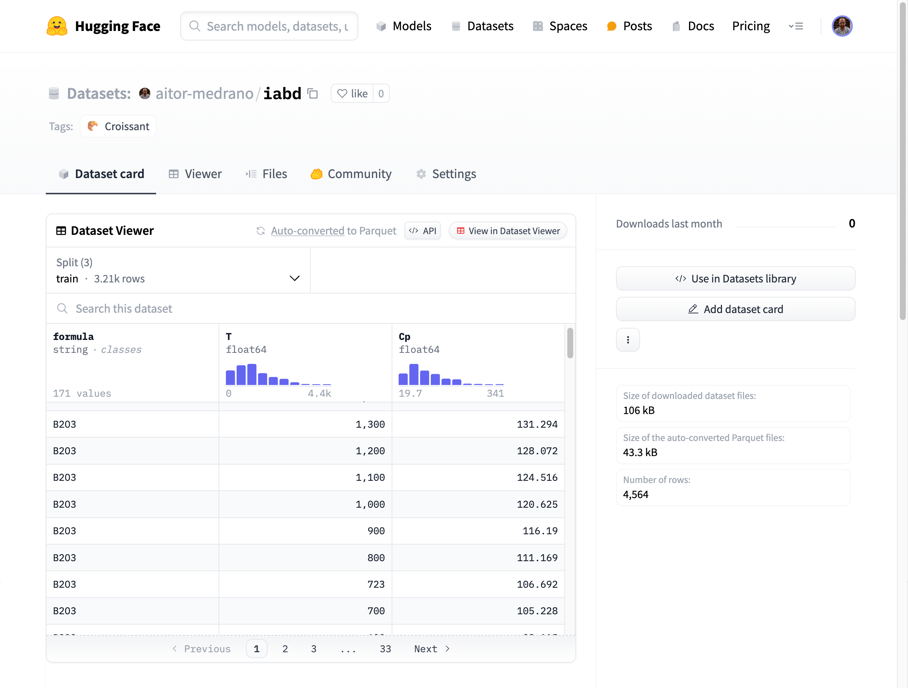

Y si editamos el archivo `README.md`, podemos añadir información extra como el tamaño del dataset, la licencia o fuera de los metadatos, toda la información que queramos como, por ejemplo, la descripción de los campos:

`README.md`

```yaml
---
size_categories:
- 1K<n<10K
---

Extraído de <https://github.com/anthony-wang/BestPractices/tree/master/data>.

Campos:

* Formula (`string`)
* T (`float64`): Temperatura (K)
* CP (`float64`): Capacidad calorífica (J/mol K)
```

Para terminar, si queremos usar nuestro *dataset*, de la misma forma que antes, usaremos el método `load_dataset`, indicando el usuario y el nombre del dataset:

```python
from datasets import load_dataset

iabd_dataset = load_dataset("aitor-medrano/iabd")
print(iabd_dataset)
```

Y al ejecutarlo podemos ver la descarga de las tres partes, así como los nombres de las características y la cantidad de filas de cada uno de los *splits*:

```
Downloading readme: 100%|...| 229/229 [00:00<00:00, 478kB/s]
Generating train split: 3214 examples [00:00, 148561.75 examples/s]
Generating validation split: 980 examples [00:00, 530376.51 examples/s]
Generating test split: 370 examples [00:00, 289748.41 examples/s]
DatasetDict({
    train: Dataset({
        features: ['formula', 'T', 'Cp'],
        num_rows: 3214
    })
    validation: Dataset({
        features: ['formula', 'T', 'Cp'],
        num_rows: 980
    })
    test: Dataset({
        features: ['formula', 'T', 'Cp'],
        num_rows: 370
    })
})
```

### Actividad · Crea un dataset del Titanic

Crea un dataset en Hugging Face a partir de los datos de entrenamiento ([`titanic_train.csv`](../assets/resources/titanic_train.csv)) y pruebas ([`titanic_test.csv`](../assets/resources/titanic_test.csv)) del [Titanic](https://www.kaggle.com/c/titanic/data). A continuación, desde Python con la librería `datasets`, recupera los datos y muestra sus características.

*(Actividad 5 de Aitor Medrano: RAPIA.3 / CEPIA.3b, CEPIA.3c / 2p.)*

---

> 📄 Fuente: [Hugging Face — Aitor Medrano](https://aitor-medrano.github.io/iabd/hf/hf.html) (CC BY-NC-SA 4.0). Contenido reproducido con su autorización.
