# Sesión 34 · Hub: Spaces y Modelos (25/11/2026)

> Contenido reproducido con la autorización de **Aitor Medrano** (I.E.S. Severo Ochoa), de sus apuntes [Hugging Face](https://aitor-medrano.github.io/iabd/hf/hf.html) (CC BY-NC-SA 4.0). Texto, imágenes y enlaces copiados tal cual.

## Spaces

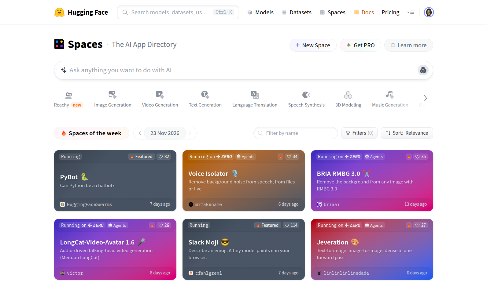

Mediante los espacios podemos construir y desplegar modelos de IA, así como aplicaciones de demostración para probarlos. Los Spaces son repositorios Git que alojan el código de aplicaciones para demostraciones de ML (aprendizaje automático). 

Podemos crear *demos* de forma rápida, con unas pocas líneas de *Python*, con la librería [Gradio](https://www.gradio.app/) o imágenes de Docker y utilizar controles multimodales que facilitan el testeo de los modelos.

Por ejemplo, si vamos a los espacios, podemos ordenarlos por los que tienen más *likes*, y entrar a [MusicGen](https://huggingface.co/spaces/facebook/MusicGen) y ver los diferentes controles para introducir texto, subir un archivo, así como posteriormente reproducir un audio o un vídeo:

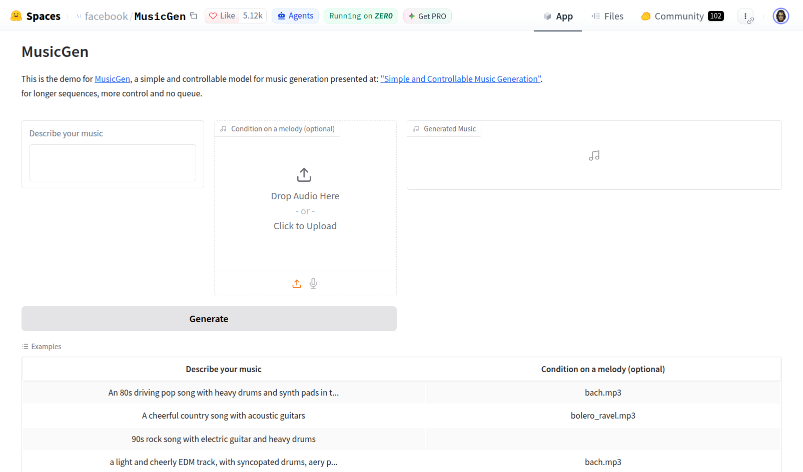

Otros espacios no tienen apariencia de formulario, como [FacePoke](https://huggingface.co/spaces/jbilcke-hf/FacePoke) (prueba a subir una foto de un retrato, o una versión menos interactiva como [expression-editor](https://huggingface.co/spaces/fffiloni/expression-editor)), o permiten el uso de la aplicación en tiempo real como [Realtime-whisper-large-v3-turbo](https://huggingface.co/spaces/KingNish/Realtime-whisper-large-v3-turbo), pudiendo ofrecer elementos de ejemplo para probar los modelos como [Kolors-Virtual-Try-On](https://huggingface.co/spaces/Kwai-Kolors/Kolors-Virtual-Try-On).

Más adelante nos centraremos en *Gradio* para la creación del interfaz de usuario.

El uso básico de los espacios es **gratuito**, pero si necesitamos emplear GPU puede ser que necesitemos pagar por su uso.

> 🎯 **Actividad 1** (RAMIA.1 / CEMIA.1d, CEMIA.1e / 2p). Vamos a construir, paso a paso, un **Space de Gradio que traduce** (reutilizando el traductor de la sesión anterior), primero en Hugging Face y luego en local. Los pasos guiados están marcados abajo; antes de cada uno tienes los apuntes que necesitas.

### Actividad 1 · Paso 1: Crea el Space

1. Ve a tu perfil de Hugging Face → pestaña **Spaces** → **Create new Space**.
2. Configúralo: **nombre** (p. ej. `iabd`), **licencia**, **SDK = Gradio**, **plantilla = Blank**, **hardware = CPU (gratis)** y **visibilidad = Público**.
3. Pulsa **Create Space**.

### Apuntes · Crear un Space

Para familiarizarnos con ellos, vamos a crear nuestro espacio que utilizaremos a lo largo del bloque. Para ello, dentro de la pestaña [*Spaces*](https://huggingface.co/spaces), creamos uno nuevo (*New Space*), y vemos cómo primero indicamos un nombre, una licencia, el SDK que utilizaremos para el prototipado, el hardware empleado y la visibilidad del mismo:

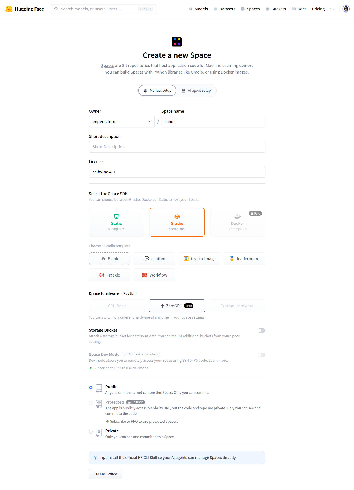

En nuestro caso, vamos a coger la instancia gratuita y elegiremos un proyecto *Gradio* con una plantilla en blanco (*blank*). 

Como se puede observar, podemos elegir entre diferentes plantillas: HTML5 estáticas, Gradio, Docker o Static para alojar nuestro espacio.

**Plantillas estáticas HTML5**
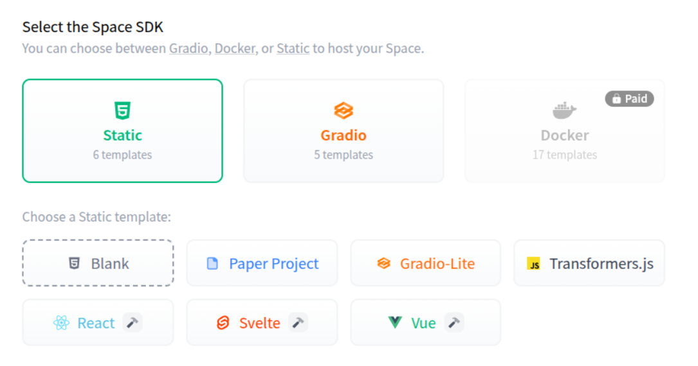

**Plantilla Gradio**
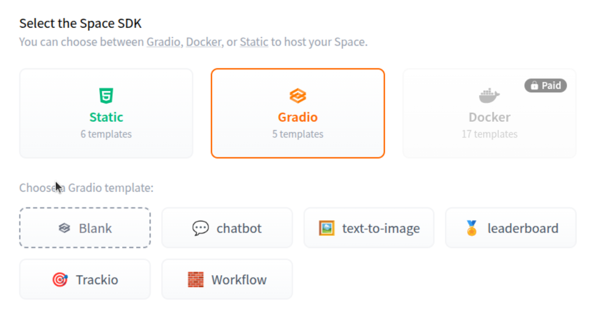


> 💡 **ZeroGPU** es la alternativa gratuita con GPU: en vez de una GPU dedicada (de pago), te deja usar una **GPU compartida de forma dinámica**, asignada solo mientras tu código la necesita. Exige escribir la inferencia como *functions* con `@spaces.GPU` (librería `spaces`) y está pensada para **demos con inferencia puntual**, no para entrenamientos largos.

> 💡 **Store Bucket (Cubo de almacenamiento)** Podemos usar un *Bucket* (cubo de almacenamiento) para datos persistentes. Podemos montar cubos adicionales desde la configuración de nuestro Space.

Finalmente, seleccionamos que queremos hacer nuestro espacio en abierto, para que sea accesible por cualquiera.


Tras ello, nos saldrá una página con información para clonar el repositorio creado:

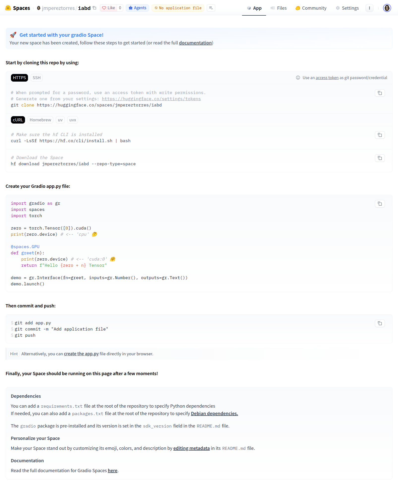

En nuestro caso, vamos a añadir la aplicación inicial desde el navegador pulsando sobre el enlace "**create the app.py**": 


Añadimos el siguiente fragmento que emplea *Gradio*: 

`app.py`

```python
import gradio as gr
import spaces
import torch

zero = torch.Tensor([0]).cuda()
print(zero.device) # <-- 'cpu' 🤔

@spaces.GPU
def saluda(nombre):
    print(zero.device) # <-- 'cuda:0' 🤗
    return "Hola " + nombre + "!"

demo = gr.Interface(
    fn=saluda,          #
    inputs="text",      #input text
    outputs="text")     #input text

demo.launch(share=True) 
```
Posteriormente realizamos un *commit* desde la interfaz web:

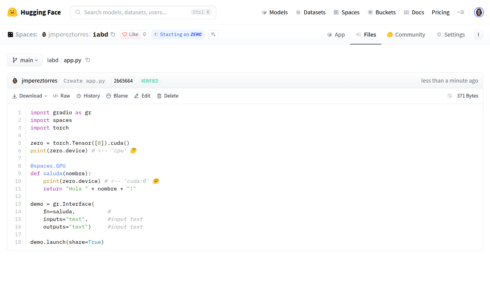

Si ahora vamos a nuestro perfil, podremos ver cómo se ha creado el espacio. Si pulsamos en **App** aparecerá la aplicación:

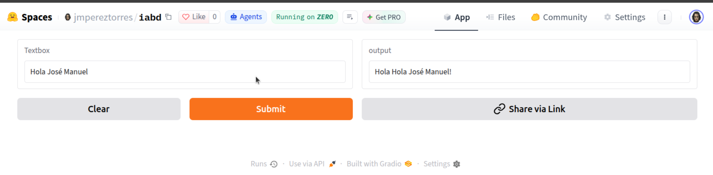

### Actividad 1 · Paso 2: Escribe el `app.py`

Sustituye el contenido del fichero `app.py` por:

```python
import spaces                      # 1º: antes que transformers
import gradio as gr
from transformers import AutoTokenizer, AutoModelForSeq2SeqLM

# Cargamos el modelo de traducción EN→ES y su tokenizador (transformers v5)
modelo = AutoModelForSeq2SeqLM.from_pretrained("Helsinki-NLP/opus-mt-en-es")
tokenizer = AutoTokenizer.from_pretrained("Helsinki-NLP/opus-mt-en-es")

# @spaces.GPU indica a ZeroGPU que esta función ejecuta la inferencia
@spaces.GPU
def traducir(texto):
    # return_tensors="pt" convierte el texto en tensores de PyTorch (números),
    # porque un modelo no entiende letras, solo números.
    entradas = tokenizer(texto, return_tensors="pt")

    # generate() produce los tokens de salida y decode() los vuelve a convertir
    # a texto. skip_special_tokens=True omite los tokens especiales
    # (como <s> de inicio o </s> de fin de frase).
    return tokenizer.decode(modelo.generate(**entradas)[0], skip_special_tokens=True)

demo = gr.Interface(
    fn=traducir,
    inputs=gr.Textbox(label="Inglés", placeholder="Escribe aquí..."),
    outputs="text",
    title="Traductor EN → ES",
    examples=["I like to play basketball"],
)
demo.launch()
```

> ℹ️ Usamos **transformers v5** (eliminó la tarea `translation`, por eso `AutoModelForSeq2SeqLM`) y **ZeroGPU** (por eso `import spaces` al principio y `@spaces.GPU` en la función). 

!!! info "Versión 4 (solo como referencia)"
    Con `transformers` v4 bastaba con un `pipeline`:

    ```python
    from transformers import pipeline

    # El pipeline se encarga de todo: tokenizador + modelo + postprocesado.
    traductor = pipeline("translation", model="Helsinki-NLP/opus-mt-en-es")

    def traducir(texto):
        return traductor(texto)[0]["translation_text"]
    ```

    Ver [Migración v4 → v5](../recursos/migracion_v5.md).

### Actividad 1 · Paso 3: Publica y prueba

**1.-** Haz **Commit** del `app.py` (el Space se reconstruye automáticamente).

**¿Funciona?** Si ahora volvemos a la pestaña de la aplicación veremos que ha fallado:

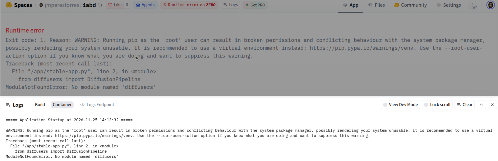

**¿El motivo?** Claramente no hemos instalado ninguna de las librerías que necesita nuestro ejemplo. Por defecto, los *Spaces* ya tienen instaladas las librerías `huggingface_hub` para gestionar los repositorios y ficheros del Hub, `requests` para realizar llamadas a APIs externas, `datasets` para cargar y mostrar datos (la veremos en una próxima sesión) y `gradio`, el SDK seleccionado.

Para instalar otras dependencias, debemos añadir a la raíz un archivo nombrado `requirements.txt` , con `transformers`, `torch` y `sentencepiece` (necesario para `opus-mt-en-es`): 

`requirements.txt`

```text
transformers
torch
sentencepiece
```

Tras hacer el *commit* del `requirements.txt`, el Space se reconstruye y la traducción ya funciona:

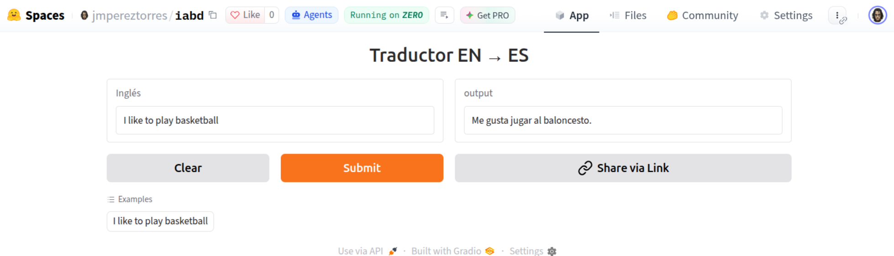

**2.-** Cuando termine, escribe una frase en inglés y verás la traducción.

**3.-** ¡Ya tienes tu Space público! Cualquiera con la URL puede usarlo.

### Apuntes · Probar en local

Para probar *Gradio* en local, el primer paso será instalar la librería:

```bash
pip install gradio
```

Y a continuación, lanzar el *script* pero en vez de con el intérprete de *Python*, con el comando `gradio`:

```bash
gradio app.py
```

¿Te aparece una dirección local y otra remota? ¿Dónde se está ejecutando el código de la URL remota?

### Actividad 1 · Paso 4: También en local

Prueba el `app.py` de tu traductor en tu ordenador:

```bash
pip install gradio transformers sentencepiece
python3 app.py
```

Se abre en `http://127.0.0.1:7860`.

### Apuntes · Configuración y dependencias

Vamos a reutilizar el ejemplo inicial de generar una imagen desde *Stable Difussion* para generar un prototipo que nos permita escribir el *prompt* y visualizar el resultado.

Para ello, desde la pestaña *Files*, añadimos un nuevo fichero con el código de nuestra aplicación que ahora llamaremos `stable-app.py` ahora será similar a:

`stable-app.py`

```python
import spaces                      # 1º: antes que torch/diffusers
import gradio as gr
from diffusers import DiffusionPipeline
import torch

# Se carga UNA sola vez, cuando el Space arranca (no en cada llamada)
pipe = DiffusionPipeline.from_pretrained(
    "sd-legacy/stable-diffusion-v1-5",
    # float16 = mitad de precisión, más rápido en GPU (ZeroGPU)
    torch_dtype=torch.float16,
)
pipe.to("cuda")

# @spaces.GPU indica a ZeroGPU que esta función usa la GPU
@spaces.GPU
def stable(prompt):
    # pipe(prompt) genera la imagen; .images[0] es la primera (y única) imagen
    return pipe(prompt).images[0]

demo = gr.Interface(fn=stable, inputs="text", outputs="image")
demo.launch()
```

> 💡 **ZeroGPU** (GPU gratis, por defecto en muchos Spaces): hay que importar `spaces` al principio y marcar la función con `@spaces.GPU`. El modelo se carga a nivel de módulo con `.to("cuda")` (ZeroGPU activa un modo de emulación CUDA que lo permite).

Para indicarle al *Space* que este fichero es la nueva aplicación, editamos el fichero `README.md` que contiene la configuración del espacio (título, colores del banner, descripción y el nombre del *script* que lanza la aplicación):

`README.md`

```yaml
---
title: IABD
emoji: 🌍
colorFrom: blue
colorTo: indigo
sdk: gradio
sdk_version: 6.32.0
app_file: stable-app.py
pinned: false
license: cc-by-nc-4.0
short_description: Probando los Spaces en IABD
---
```

Algunos de los campos los podemos editar directamente desde el interfaz gráfico, pero también podemos editar directamente el archivo:

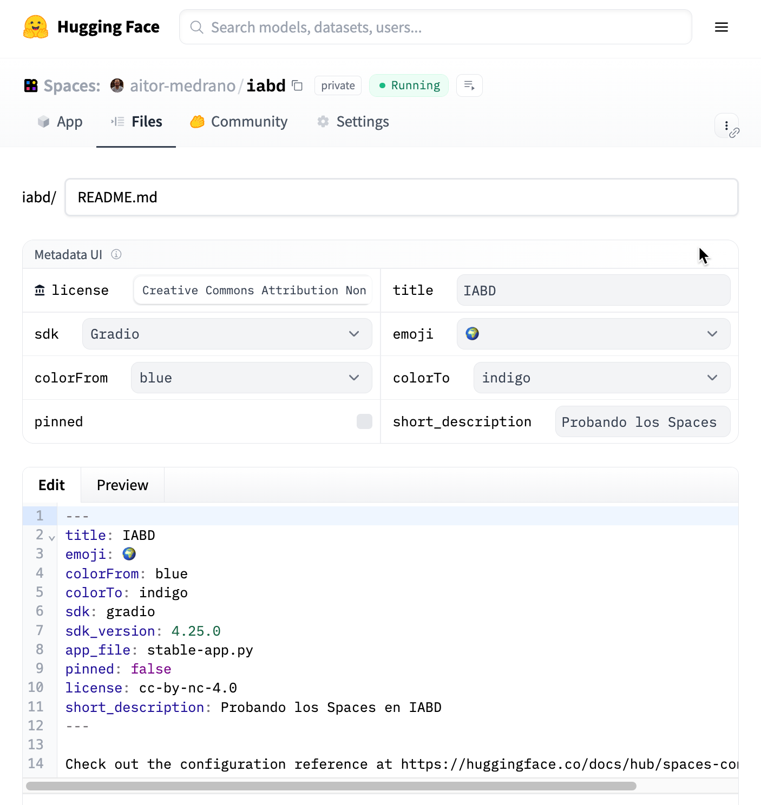

Si ahora volvemos a la pestaña de la aplicación veremos que ha fallado:


**¿El motivo?** Claramente no hemos instalado ninguna de las librerías que necesita nuestro ejemplo. Por defecto, los *Spaces* ya tienen instaladas las librerías `huggingface_hub` para gestionar los repositorios y ficheros del Hub, `requests` para realizar llamadas a APIs externas, `datasets` para cargar y mostrar datos (la veremos en una próxima sesión) y `gradio`, el SDK seleccionado.

Para instalar otras dependencias, editaremos el fichero `requirements.txt` añadiendo `diffusers` y `accelerate`:

`requirements.txt`

```text
transformers
torch
sentencepiece
diffusers
accelerate
```

Tras hacer el *commit* del archivo, el espacio volverá a construirse. Y tras ello, ya podemos introducir nuestro *prompt* y, gracias a ZeroGPU, ver el resultado en pocos segundos:

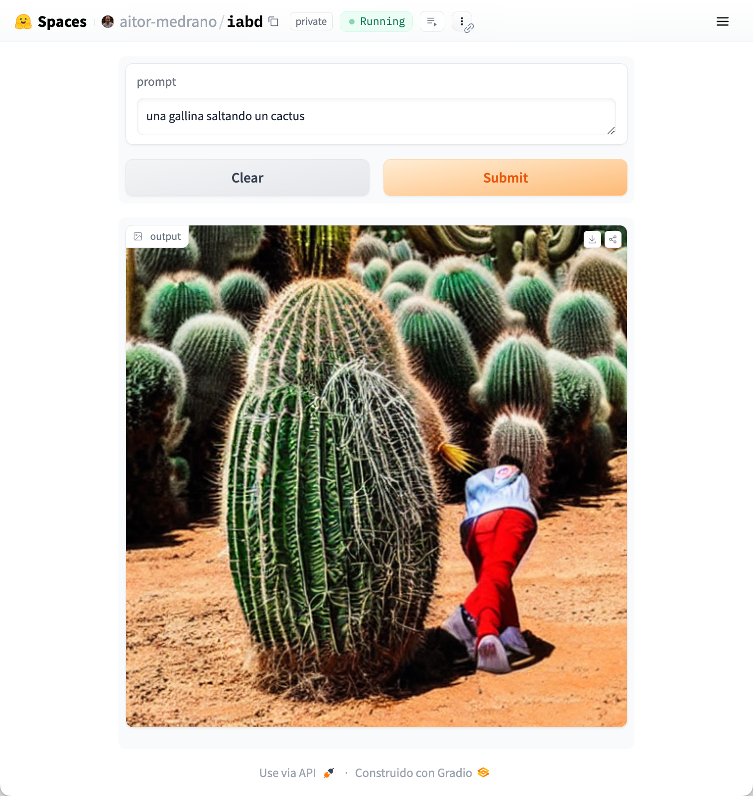

### Actividad 1 · Tu toque personal (completa la actividad)

Para que el Space sea **tuyo** (y no una copia del profesor), añade las siguientes mejoras:

- Cambia el **par de idiomas** (p. ej. ES → EN, u otro modelo de `Helsinki-NLP`).
- Añade **ejemplos** propios a la interfaz.
- Cambia el **título, descripción o tema** del Space.
- Añade un `requirements.txt` con las dependencias y una **descripción** en el README.

**Entregable:** la URL de tu Space + una captura de la app funcionando (en HF y en local).

## Modelos

> 🎯 **Actividad 2** (RAPIA.3 / CEPIA.3b, CEPIA.3c / obligatoria). Todo este apartado lo haremos **conjuntamente**: crea un modelo, configura tu clave SSH y sube los archivos del modelo de perros/gatos, **pegando una captura de cada paso** en un documento. Al final, de forma **individual**, harás la inferencia con Python usando un `pipeline`.

*Hugging Face* ofrece multitud de modelos que podemos probar y utilizar en nuestras aplicaciones. Además, si queremos, podemos utilizar alguna técnica de transferencia de conocimiento para crear nuestros propios modelos adaptados a nuestras necesidades.

Si entramos a la página de [Modelos](https://huggingface.co/models), podemos buscar un modelo por tarea o palabra clave, y ordenar los resultados por popularidad, tendencia o actualizaciones recientes.


Si entramos a un modelo en concreto, por ejemplo a [speecht5_tts](https://huggingface.co/microsoft/speecht5_tts) o [opus-mt-en-es](https://huggingface.co/Helsinki-NLP/opus-mt-en-es), podemos ver una ficha con información del modelo como el método de entrenamiento, la licencia de uso, estadísticas de uso e interacciones de la comunidad, herramientas para utilizar el modelo (Inference API) o importarlo en nuestro propio código, así como qué espacios utilizan este modelo.

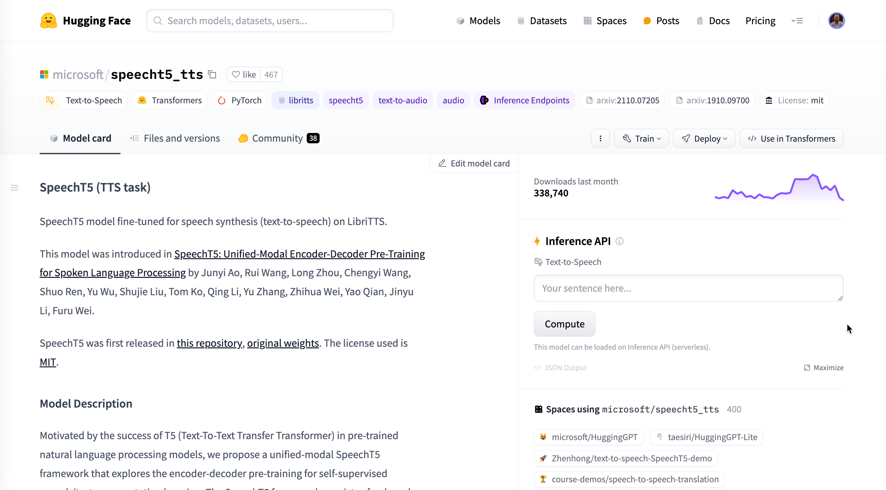

Por último, la página [tareas](https://huggingface.co/tasks) (*Tasks*) agrupa todos los modelos de IA por su utilidad:

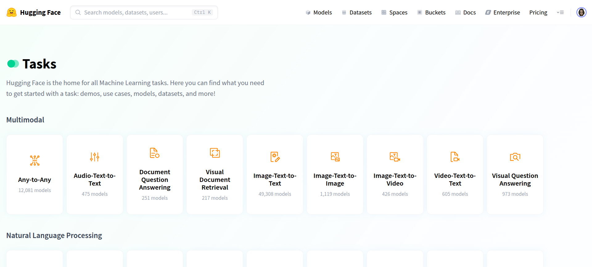

También podemos acceder desde el menú de opciones (no está muy accesible):

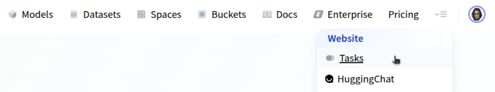

### Creando un modelo

El primer paso es crear un modelo que implícitamente inicializará un repositorio donde almacenar el código fuente y los artefactos.

Para crear el modelo, de forma similar a cómo hicimos al crear el espacio, vamos a nuestro perfil y pulsamos sobre `+ New Model`. 

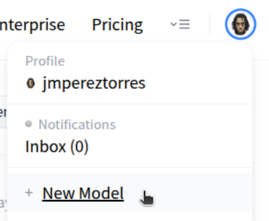

Le ponemos el nombre **`iabd_model`** y la licencia `cc-by-nc-4.0`: 

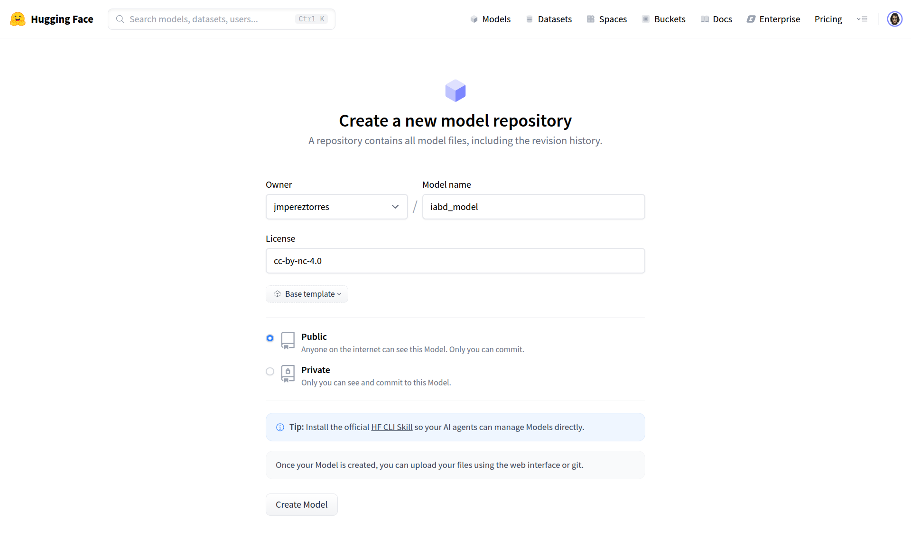

Tras ponerle un nombre y una licencia, accederemos a su panel donde tenemos por una parte una **Model Card** que hace de página de inicio, la pestaña con los ficheros y versiones que hace de repositorio, así como la posibilidad de interactuar con la comunidad y las preferencias.

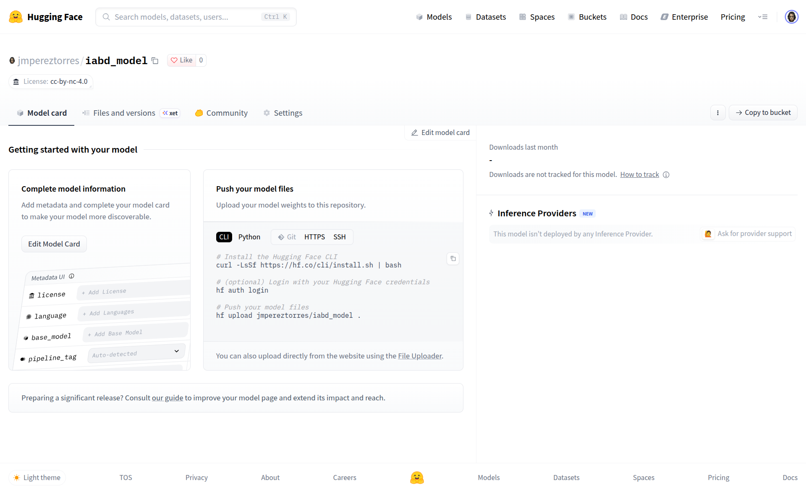

Vamos a ir a la pestaña de *`Files and versions`* y añadimos un archivo desde el interfaz web (`+Add file`), por ejemplo, lo nombramos `authors.txt` y ponemos nuestro nombre en el contenido:


Y si ahora vamos a la pestaña de archivos, vemos cómo tenemos el archivo recién añadido, así como el archivo `README.md` que nos permite configurar la página de inicio de nuestro modelo:


### Usando Git

Para poder trabajar con el repositorio ya hemos visto que podemos hacerlo mediante el interfaz web, aunque lo más cómodo para nosotros será trabajar mediante Git y GitLFS. [GitLFS](https://git-lfs.com/) es una extensión para trabajar con archivos de gran tamaño (superiores a 10 MB), ya que es posible, que bien nuestros modelos o bien nuestros *datasets* tengan un tamaño considerable.

Así pues, como es probable que trabajemos con archivos superiores a los 10 MB, instalaremos en nuestro sistema *git-lfs*:

```bash
sudo apt-get install git-lfs # Ubuntu
brew install git-lfs    # MacOS
```
#### 🪟 Windows
* **Con Winget (Recomendado):**
  ```powershell
  winget install -e --id GitHub.GitLFS
  ```
* **Con Chocolatey / Scoop:**
  ```powershell
  choco install git-lfs
  # o bien:
  scoop install git-lfs
  ```
* **Instalador manual:** Descargar el `.exe` desde [git-lfs.com](https://git-lfs.com) o marcar la opción incluida al instalar **Git for Windows**.

---

#### Usando SSH

Para evitar tener que poner el usuario y contraseña al hacer *push*, es más cómodo generar una clave SSH y subirla a nuestro perfil.

Antes de [generar una clave](https://huggingface.co/docs/hub/en/security-git-ssh#generating-a-new-ssh-keypair), es posible que ya tengamos una generada en `~/.ssh` (*Linux/MacOS*) o en `C:\Users\<usuario>\.ssh` (*Windows*) con algún archivo similar a `id_rsa.pub`. Si no fuera el caso, sí que tenemos que generar una clave y añadirla al agente:

```bash
ssh-keygen
ssh-add ~/.ssh/id_rsa
```

A continuación, vamos a las preferencias del usuario, y en la opción *SSH and GPG Keys*, creamos una nueva clave, poniendo como identificador, por ejemplo, el nombre de nuestro ordenador, y en la clave, pegamos el contenido del archivo `.pub` generado anteriormente.

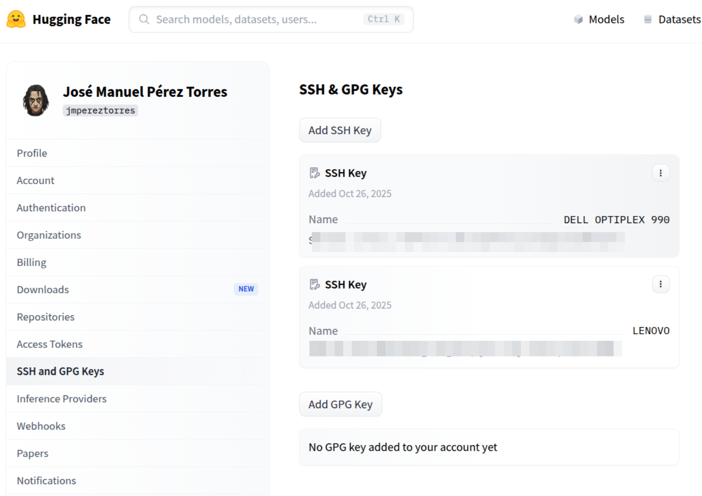

Y haciendo uso de git, clonamos el repositorio:

```bash
git clone git@hf.co:jmpereztorres/iabd_model
cd iabd_model
```

Y comprobamos cómo se han descargado los archivos del modelo, incluyendo el que hemos creado previamente:

```bash
% ls
README.md       authors.txt
```

Y habilitamos Git-LFS:

```bash
git lfs install
```

Si nuestros ficheros van a superar los 5GB, también deberemos habilitarlos en *Hugging Face*:

```bash
huggingface-cli lfs-enable-largefiles .
```

Para seguir con este ejemplo, vamos a descargarnos los archivos del modelo [`omarques/autotrain-dogs-and-cats-1527055142`](https://huggingface.co/omarques/autotrain-dogs-and-cats-1527055142) (`config.json`, `preprocessor_config.json` y el modelo `pytorch_model.bin`) y pegarlos dentro de nuestra carpeta `iabd_model`. Tras ello, los subimos mediante Git al repositorio:

```bash
git add .
git commit -m "Primera version"
git push
```

Si ahora vamos a la página web, veremos cómo ya aparecen los mismos archivos y cómo el archivo `pytorch_model.bin` se ha marcado como LFS:

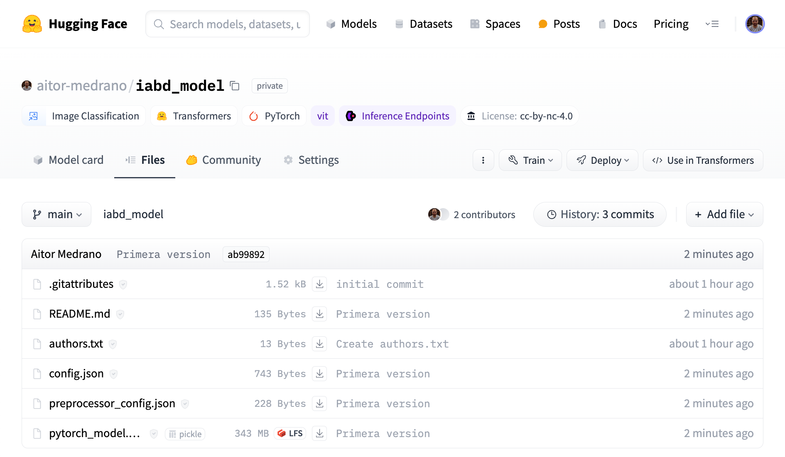

### Model Card

La [tarjeta del modelo](https://huggingface.co/docs/hub/model-cards) aporta información muy útil, como es la categoría de este, así como librerías, *datasets*, idiomas o los resultados obtenidos en la fase de evaluación del modelo.

Si nos fijamos en la tarjeta del modelo que hemos [escogido anteriormente](https://huggingface.co/omarques/autotrain-dogs-and-cats-1527055142), podemos ver toda la información mostrada, con las diferentes etiquetas (*Image Classification*, *Pytorch*, etc...), así como las estadísticas y el bloque para probar el modelo directamente:

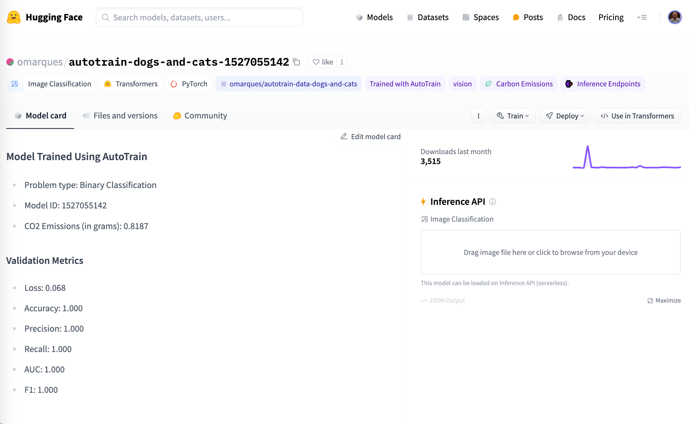

Así pues, vamos a editar nuestra tarjeta, y añadiremos los siguientes elementos:

`README.md`

```yaml
tags:
- vision
- image-classification
datasets:
- omarques/autotrain-data-dogs-and-cats
```

De manera que ahora nuestro modelo tendrá la siguiente apariencia:

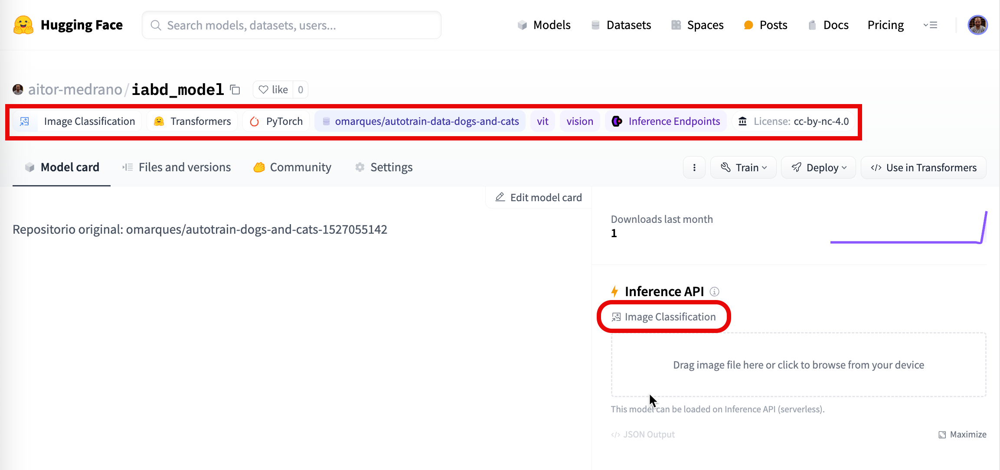

En próximas sesiones donde nos centremos en el *fine-tuning*, volveremos a la tarjeta del modelo para anotar toda la información obtenida.

### Inference API

Si vamos a la tarjeta de nuestro modelo, si nuestro modelo tiene suficiente visibilidad social (*likes*) veremos que en la parte derecha se ha marcado dentro del bloque de *Inference API* que se trata de un modelo de clasificación de imágenes y nos permite arrastrar una imagen.

Esta API utiliza un [widget](https://huggingface.co/docs/hub/en/models-widgets) el cual obtiene información de los metadatos del modelo y del archivo de configuración (`config.json`) para saber qué interfaz mostrar. Si queremos, podemos indicarlo de forma explícita mediante el `pipeline_tag` de la tarjeta del modelo, por ejemplo, en nuestro caso `image-classification`.

Por ejemplo, si le pasamos una [foto](../assets/images/34/aitor_perro-gato.jpg) al bloque, veremos cómo se carga el modelo y al finalizar, nos muestra la predicción que ha realizado categorizando la imagen:

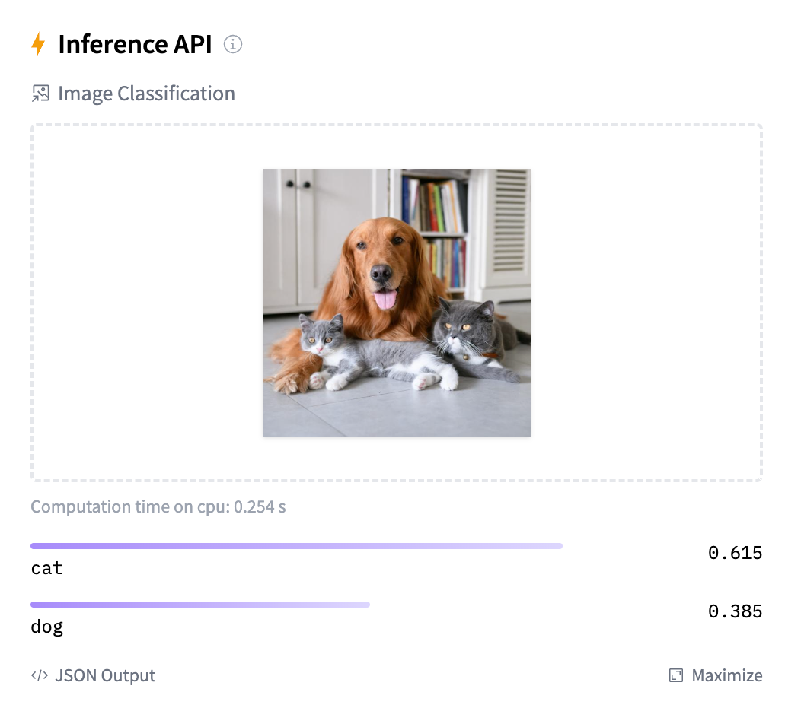

#### Valores de ejemplo

Aunque a priori se pueden [añadir elementos](https://huggingface.co/docs/hub/models-widgets#how-can-i-control-my-models-widget-example-input) para probar el modelo directamente, actualmente no funciona, al menos, para poner imágenes de entrada.

### Pipelines

Ya hemos estudiado anteriormente que los *pipelines* son una abstracción para realizar inferencia sobre los modelos, simplificando el código complejo mediante un API dedicada a tareas.

Por ejemplo, podemos utilizarlo pasándole por parámetro la tarea a realizar o el modelo a utilizar:

```python
from transformers import pipeline

pipe = pipeline("text-classification")
result = pipe("Me encanta venir a clase al IES Severo Ochoa")
print(result)
# Salida orientativa: [{'label': 'POSITIVE', 'score': 0.9998743534088135}]
```

Si queremos, podemos indicarle, además de la tarea, qué modelo queremos emplear:

```python
from transformers import pipeline

pipe = pipeline("text-generation", model="openai-community/gpt2")
result = pipe("What is big data?")
print(result)
```

> ⚠️ En v4 había `text2text-generation` para traducir, pero en `transformers` v5 se eliminó. Para traducir en v5, usa el modelo y el tokenizador directamente:

```python
from transformers import AutoTokenizer, AutoModelForSeq2SeqLM

modelo = AutoModelForSeq2SeqLM.from_pretrained("google/flan-t5-base")
tokenizer = AutoTokenizer.from_pretrained("google/flan-t5-base")

entradas = tokenizer("translate from spanish to english: Me encanta disfrutar las vacaciones en la playa", return_tensors="pt")
print(tokenizer.decode(modelo.generate(**entradas)[0], skip_special_tokens=True))
```

El listado de tareas disponibles se pueden consultar en la API del método `transformers.pipeline` con el parámetro [`task`](https://huggingface.co/docs/transformers/main_classes/pipelines#transformers.pipeline.task), por ejemplo, `audio-classification`, `image-segmentation`, `image-classification`, `token-classification`, etc...

### Tu parte (individual) · Inferencia con Python

Una vez subidos los archivos del modelo (hecho conjuntamente), realiza **individualmente** la inferencia con Python usando un `pipeline`:

```python
from transformers import pipeline

clasificador = pipeline("image-classification", model="tu-usuario/mi-modelo")
print(clasificador("perro.jpg"))
```

**Entregable:** un documento con las capturas de todo el proceso (crear modelo, SSH, subir archivos) + tu script de inferencia ejecutado.

---

> 📄 Fuente: [Hugging Face — Aitor Medrano](https://aitor-medrano.github.io/iabd/hf/hf.html) (CC BY-NC-SA 4.0). Contenido reproducido con su autorización.
