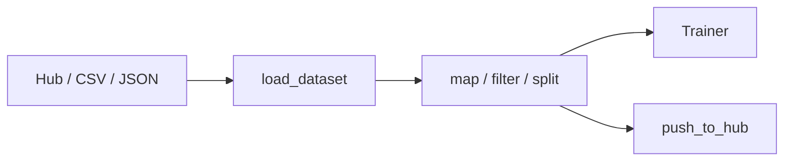
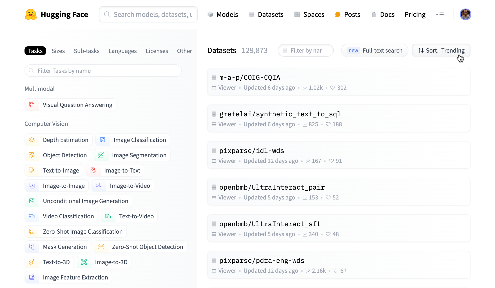
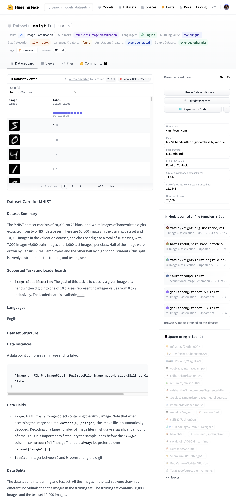
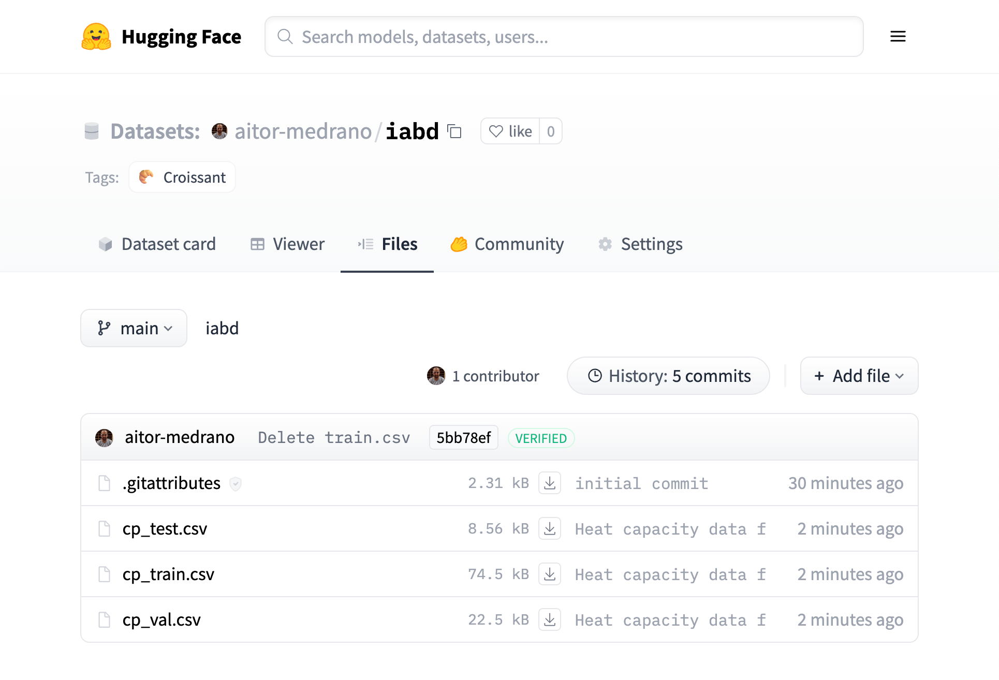
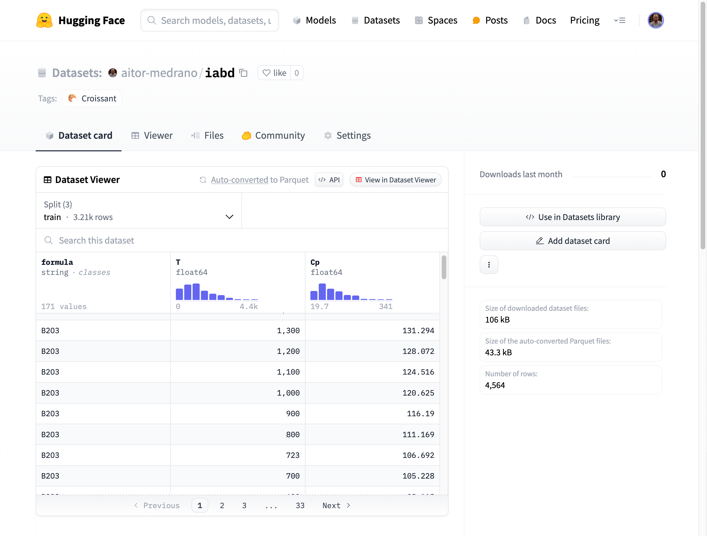

# Sesión 36 · La librería Datasets (30/11/2026)

> **Objetivo:** cargar, transformar y publicar datos listos para entrenar.
>
> Formato: ~30 min de explicación · ~75 min de notebook guiado · ~15 min de reto.

## Qué vas a aprender

| # | Al terminar la sesión serás capaz de… |
|---|---|
| 1 | Cargar datasets del Hub y de CSV/JSON locales (`load_dataset`) |
| 2 | Transformar con `map`, `filter`, `select`, `train_test_split` y `class_encode_column` |
| 3 | Explicar Arrow, caché y streaming, y pasar datos a pandas/PyTorch |
| 4 | Crear, persistir y publicar un dataset propio en el Hub |

## Cuaderno de la sesión

[Abrir en Colab](https://colab.research.google.com/github/jmperez-profesor/hf/blob/main/docs/sesiones/sesion36_datasets.ipynb){ .md-button } · [ver en el sitio](sesion36_datasets.ipynb)

## 1 · Cargar datos



```python
from datasets import load_dataset

dataset = load_dataset("stanfordnlp/imdb")              # desde el Hub
local = load_dataset("csv", data_files="resenas.csv")   # CSV local
remoto = load_dataset("json", data_files="https://.../datos.json")  # URL
print(dataset)   # DatasetDict con splits train/test
```

## 2 · Transformar

```python
def tokenizar(ejemplo):
    return tokenizer(ejemplo["text"], truncation=True, padding="max_length")

tokenizado = dataset.map(tokenizar, batched=True)         # aplicar a todo
filtrado = dataset.filter(lambda e: len(e["text"]) > 50)  # filtrar
split = dataset["train"].train_test_split(test_size=0.2)  # particionar
```

- **Arrow:** formato columnar eficiente; los datos se cachean en disco.
- **Streaming:** para datasets que no caben en memoria (`load_dataset(..., streaming=True)`), devuelve un `IterableDataset` (se recorre con `next(iter(...))` y se procesa al vuelo).
- **`set_format("torch")`** pasa a tensores; **`DataCollatorWithPadding`** hace padding dinámico por lote.

## 3 · Crear, persistir y publicar

```python
from datasets import Dataset

datos = [{"texto": "me encanta", "label": 1}, {"texto": "no me gusta", "label": 0}]
ds = Dataset.from_list(datos)          # o from_dict(...)

ds.save_to_disk("mi_dataset")          # Arrow (rápido, comprimido)
ds.to_parquet("mi_dataset.parquet")    # o to_csv / to_json
from datasets import load_from_disk
ds = load_from_disk("mi_dataset")
```

Para **publicarlo en el Hub** (token de escritura):

```python
from huggingface_hub import login
login()                                # pega tu token
ds.push_to_hub("tu-usuario/mi-dataset")
```

## Datasets en el Hub

Además, *Hugging Face* ofrece un entorno para la utilización y publicación de *datasets*, organizados por categorías, tamaños, lenguajes y licencias de uso:



Por ejemplo, uno de los *datasets* más utilizados al estudiar redes neuronales es el [MNIST](https://huggingface.co/datasets/mnist) que contiene 70.000 imágenes de 28x28 en blanco y negro con los dígitos transcritos. Como podemos observar, el entorno ofrece previsualización de todas las columnas, así como la posibilidad de utilizar el *dataset* con unas pocas líneas de código:



Si queremos usar el *dataset*, podemos pulsar sobre el botón *Use in Datasets library* o codificar el siguiente fragmento:

```python
from datasets import load_dataset

mnist_dataset = load_dataset("mnist")
print(mnist_dataset)
# DatasetDict({
#     train: Dataset({
#         features: ['image', 'label'],
#         num_rows: 60000
#     })
#     test: Dataset({
#         features: ['image', 'label'],
#         num_rows: 10000
#     })
# })
```

Y si queremos acceder a una imagen:


```python
imagen = mnist_dataset["train"]["image"][0]
etiqueta = mnist_dataset["train"]["label"][0]
print(etiqueta) # 5
```

Además, al abstraer los datos dentro de la librería *datasets*, se crea la estructura de datos necesaria para entrenar los modelos más fácilmente mediante la clase [`Trainer`](https://huggingface.co/docs/transformers/main/en/trainer) que facilita realizar el mismo proceso de *fine-tuning* a diferentes modelos (esto lo estudiaremos más adelante en la sesión sobre *fine-tuning*).

### Creando nuestro dataset

Aunque ya hemos visto cómo utilizar la librería *datasets* para cargar, filtrar y persistir *datasets*, vamos a ver cómo crear un *dataset* en *HuggingFace* para almacenar los datos. Para ello, el primer paso es crearlo desde el interfaz gráfico, y a continuación, podemos acceder a la pestaña de *Files* y subiremos, por ejemplo, los datos de [`cp_train.csv`](../assets/resources/cp_train.csv), [`cp_test.csv`](../assets/resources/cp_test.csv) y [`cp_val.csv`](../assets/resources/cp_val.csv):



Una vez añadidos los archivos, automáticamente se mostrará la información (ya que los nombres de archivos contienen token reconocidos, como `test`, `train`, `val`...). Más información en [https://huggingface.co/docs/datasets/repository_structure](https://huggingface.co/docs/datasets/repository_structure):



Y si editamos el archivo `README.md`, podemos añadir información extra como el tamaño del dataset, la licencia o fuera de los metadatos, toda la información que queramos como, por ejemplo, la descripción de los campos:

`README.md`

```yaml
---
size_categories:
- 1K<n<10K
---

Extraído de <https://github.com/anthony-wang/BestPractices/tree/master/data>.

Campos:

* Formula (`string`)
* T (`float64`): Temperatura (K)
* CP (`float64`): Capacidad calorífica (J/mol K)
```

Para terminar, si queremos usar nuestro *dataset*, de la misma forma que antes, usaremos el método `load_dataset`, indicando el usuario y el nombre del dataset:

```python
from datasets import load_dataset

iabd_dataset = load_dataset("aitor-medrano/iabd")
print(iabd_dataset)
```

Y al ejecutarlo podemos ver la descarga de las tres partes, así como los nombres de las características y la cantidad de filas de cada uno de los *splits*:

```
Downloading readme: 100%|...| 229/229 [00:00<00:00, 478kB/s]
Generating train split: 3214 examples [00:00, 148561.75 examples/s]
Generating validation split: 980 examples [00:00, 530376.51 examples/s]
Generating test split: 370 examples [00:00, 289748.41 examples/s]
DatasetDict({
    train: Dataset({
        features: ['formula', 'T', 'Cp'],
        num_rows: 3214
    })
    validation: Dataset({
        features: ['formula', 'T', 'Cp'],
        num_rows: 980
    })
    test: Dataset({
        features: ['formula', 'T', 'Cp'],
        num_rows: 370
    })
})
```

## Práctica (notebook)

Prepara un **dataset de reseñas en español** tokenizado y particionado, que se usará en la sesión 39 (fine-tuning).

## Actividad 1 · Crea y publica un dataset del Titanic

Crea un dataset en Hugging Face a partir de los datos de entrenamiento ([`titanic_train.csv`](../assets/resources/titanic_train.csv)) y de prueba ([`titanic_test.csv`](../assets/resources/titanic_test.csv)) del [Titanic](https://www.kaggle.com/c/titanic/data):

1. En el Hub, crea un nuevo **Dataset** y sube los dos CSV (como en el apartado "Creando nuestro dataset").
2. Desde Python, recupéralo con `load_dataset` y muestra sus características:

```python
from datasets import load_dataset

titanic = load_dataset("tu-usuario/titanic")
print(titanic)                     # DatasetDict con los splits train/test
print(titanic["train"].features)   # columnas y tipos
```

**Entregable:** la URL de tu dataset + la salida de los `print` (splits y características).

> ⏱️ Si te sobra tiempo (o para casa), sube también el `FuelConsumptionCo2` del curso de ML con su *dataset card* completa.

*(Actividad de Aitor Medrano: RAPIA.3 / CEPIA.3b, CEPIA.3c / 2p.)*

## Ejercicios de autoevaluación

**1.** ¿Qué devuelve `load_dataset("imdb")` y qué son los *splits*?

??? tip "Solución"
    Un `DatasetDict` con los subconjuntos ya separados (p. ej. `train` y `test`).

**2.** ¿Para qué sirve `map(..., batched=True)`?

??? tip "Solución"
    Aplica una función a todos los ejemplos por lotes, mucho más rápido que ejemplo a ejemplo.

**3.** ¿Qué es Arrow y qué aporta?

??? tip "Solución"
    El formato columnar de `datasets`: eficiente en memoria/disco y con caché; junto con streaming permite datos grandes.

## 🎬 Vídeos de la sesión

- [Hugging Face: tu puerta de entrada a la IA — Parte 1](https://www.youtube.com/watch?v=49vPqhGO0GY) — DevHack, ~22 min — datasets en Colab: `load_dataset()`, splits, `features`, `map` por batches.
- [Capítulo 5 del LLM Course oficial de HF en español](https://huggingface.co/learn/llm-course/es/chapter5/1) — carga, `map`/`filter`, `train_test_split` y subida al Hub.

## Observaciones

- En Colab gratuito usa subconjuntos (`shuffle` + `select`) para ir rápido.

## Fuentes y atribución

- Documentación oficial de `datasets`: https://huggingface.co/docs/datasets
- Apartados de crear/persistir/publicar datasets adaptados de **Aitor Medrano** (CC BY-NC-SA 4.0): https://aitor-medrano.github.io/iabd/hf/datasets.html
