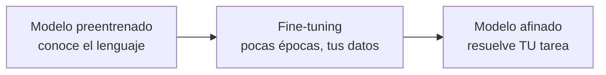
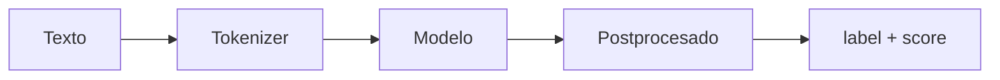
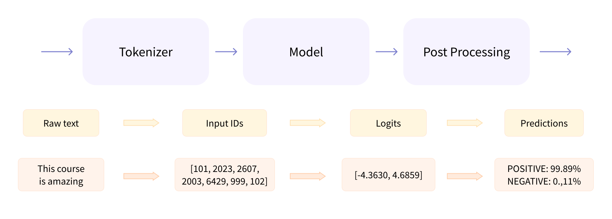
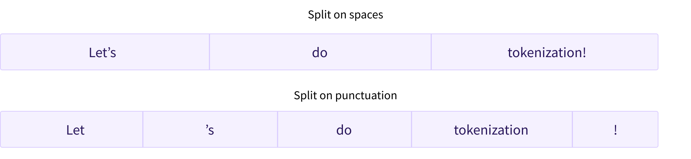
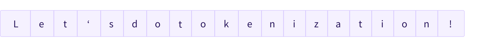
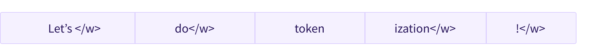
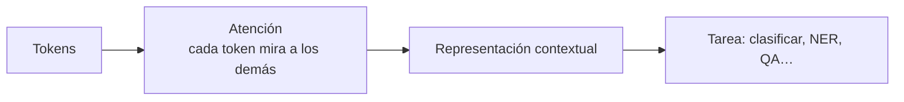
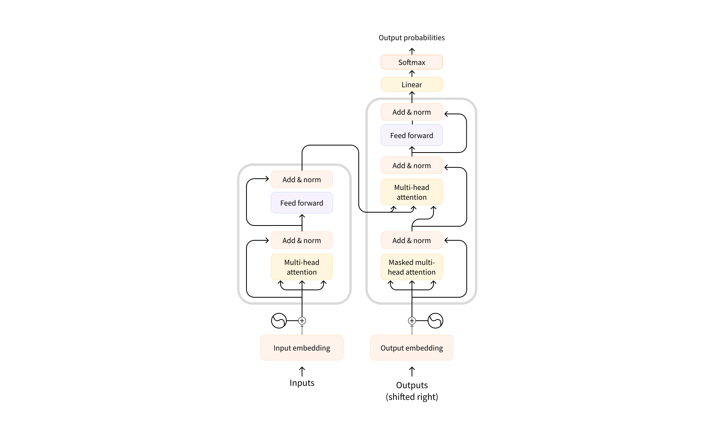

# Sesión 39 · Fine-tuning y profundización (02/12/2026)

> **Objetivo:** ajustar un modelo preentrenado a una tarea propia (fine-tuning) y profundizar en pipelines, tokenizadores y Transformers.
>
> Formato: ~30 min de explicación · ~75 min de notebook guiado · ~15 min de reto.

## Qué vas a aprender

| # | Al terminar la sesión serás capaz de… |
|---|---|
| 1 | Explicar el *transfer learning*: cuándo basta con zero-shot y cuándo ajustar |
| 2 | Montar un `Trainer` con `TrainingArguments` y una métrica de `evaluate` |
| 3 | Afinar un modelo de clasificación y evaluarlo (accuracy/F1) |
| 4 | Aprovechar la GPU (fp16/`accelerate`) y publicar con `push_to_hub` |

## Cuaderno de la sesión

[Abrir en Colab](https://colab.research.google.com/github/jmperez-profesor/hf/blob/main/docs/sesiones/sesion39_finetuning.ipynb){ .md-button } · [ver en el sitio](sesion39_finetuning.ipynb)

Cuadernos de profundización: [pipelines](sesion34_pipelines.ipynb) · [tokenizadores](sesion34_tokenizadores.ipynb) · [transformers](sesion34_transformers.ipynb)

## 1 · Transfer learning aplicado

El **fine-tuning** reentrena un modelo preentrenado durante pocas épocas con tus datos. Regla práctica: para tareas genéricas basta con **zero-shot** (visto en S29_31); cuando tu dominio es específico, **ajusta** el modelo.



## 2 · `Trainer` y `evaluate`

```python
from transformers import AutoModelForSequenceClassification, Trainer, TrainingArguments
import evaluate, numpy as np

modelo = AutoModelForSequenceClassification.from_pretrained("distilbert-base-uncased", num_labels=2)

args = TrainingArguments(
    output_dir="./resultados", evaluation_strategy="epoch",
    num_train_epochs=1, per_device_train_batch_size=16,
    fp16=True,                      # precisión mixta (GPU)
)

accuracy = evaluate.load("accuracy")
def metricas(eval_pred):
    logits, etiquetas = eval_pred
    return accuracy.compute(predictions=np.argmax(logits, -1), references=etiquetas)

trainer = Trainer(model=modelo, args=args,
                  train_dataset=tokenizado["train"], eval_dataset=tokenizado["test"],
                  compute_metrics=metricas)
trainer.train()
trainer.evaluate()
```

`accelerate` + `fp16`/`bf16` aprovechan la GPU. Añade `evaluate.load("f1")` para clases desbalanceadas.

## 3 · Publicar

```python
modelo.push_to_hub("tu-usuario/mi-modelo")     # genera la model card
tokenizer.push_to_hub("tu-usuario/mi-modelo")
```

## Práctica (notebook)

Ajusta un modelo **encoder en español** (p. ej. `dccuchile/bert-base-spanish-wwm-uncased` o BETO) sobre el dataset de la sesión 36 y compáralo con el **zero-shot** de la sesión 29_31.

## Reto

Afina un modelo de **NER** (`AutoModelForTokenClassification`) o de **clasificación multietiqueta**.

> 🔗 Enlaza con el [**proyecto integrador de visión**](../../recursos/proyecto_vision.md): aplica lo aprendido aquí (`Trainer`) a un modelo de imágenes.

## Ejercicios de autoevaluación

**1.** ¿Qué es el fine-tuning y qué ventaja tiene frente a entrenar desde cero?

??? tip "Solución"
    Reentrenar poco tiempo un modelo preentrenado con tus datos: menos datos, menos tiempo y mejores resultados.

**2.** ¿Qué hace `fp16=True` en `TrainingArguments`?

??? tip "Solución"
    Activa precisión mixta en GPU: entrena más rápido y con menos memoria.

**3.** ¿Qué es `push_to_hub`?

??? tip "Solución"
    Sube el modelo (y su card) al Hub para compartirlo y versionarlo.

**4.** ¿Por qué el accuracy puede engañar con clases desbalanceadas?

??? tip "Solución"
    Predecir siempre la clase mayoritaria ya da un accuracy alto sin aprender nada; conviene mirar F1 y la matriz de confusión.

## 🎬 Vídeos de la sesión

- [Capítulo 3 del NLP Course oficial de HF](https://huggingface.co/learn/nlp-course/chapter3/1) — fine-tuning de un modelo preentrenado (gratuito, inglés).

## Observaciones

- En Colab gratuito usa subconjuntos y `batch_size` bajo; `huggingface-cli login` + token solo para publicar.


---

## Parte 2 · Profundización: pipelines, tokenizadores y Transformers

# Parte A · Ecosistema y pipelines

## A1 · El ecosistema Hugging Face

HF no es una librería, es un **ecosistema**:

| Pieza | Qué resuelve |
|---|---|
| **🤗 Hub** | Catálogo de modelos, datasets y Spaces (compartir/versionar) |
| **`transformers`** | Descargar y usar modelos (inferencia y fine-tuning) |
| **`datasets`** | Cargar y preparar datos |
| **`tokenizers`** | Convertir texto en números |
| **`evaluate`** | Métricas estandarizadas |

La idea central: **no entrenas desde cero, reutilizas** (*transfer learning*).

## A2 · Leer una model card

Una *model card* documenta el modelo: **tarea, idioma, licencia, tamaño, métricas y limitaciones**. Es tu contrato antes de usarlo. Filtrar en el Hub por tarea/idioma/licencia es la mitad del trabajo.

## A3 · `pipeline()`: una tarea en una línea

```python
from transformers import pipeline

clasificador = pipeline("sentiment-analysis")
print(clasificador("Me ha encantado el producto"))
# [{'label': 'POSITIVE', 'score': 0.99...}]
```





Tareas con la misma interfaz: `"sentiment-analysis"`, `"ner"`, `"summarization"`, `"translation"`, `"zero-shot-classification"`, `"text-generation"`.

## A4 · Gradio: envuelve tu modelo en una interfaz

Con [Gradio](https://www.gradio.app/) conviertes cualquier `pipeline` en una **app web** interactiva:

```python
%pip install gradio
import gradio as gr
from transformers import pipeline

clasificador = pipeline("sentiment-analysis")

def analizar(texto):
    return clasificador(texto)[0]["label"]

gr.Interface(fn=analizar, inputs="text", outputs="text").launch()
```

> Gradio se amplía (componentes, `Blocks`) y se despliega a **Spaces** en la sesión 34.

## A5 · Elegir modelo, CPU/GPU, caché y token

- **Elegir modelo:** `pipeline("tarea", model="usuario/modelo")`. El por defecto es genérico y en inglés.
- **CPU/GPU:** `pipeline(..., device=0)` fuerza GPU; en Colab cambia a T4 en *Runtime*.
- **Caché:** los modelos se descargan una vez y se cachean en `~/.cache/huggingface`.
- **Token:** necesario para modelos privados o *gated* (`hf auth login`).

## A6 · Cuenta, CLI y token de acceso

```bash
pip install huggingface_hub
hf auth login          # pide un token de acceso
hf auth whoami         # confirma el usuario autenticado
hf cache scan          # cuánto ocupan los modelos descargados
```

El **token** puede ser de **lectura** (descargar/inferir) o de **escritura** (publicar). Se genera en *Settings → Access Tokens*.

## A7 · Spaces e Inference API

- Un **Space** es una app (Gradio/Streamlit) servida como web pública (ver sesión 34).
- La **Inference API** permite probar un modelo desde la model card o por HTTP, sin descargarlo.

---

# Parte B · Tokenizadores

## B1 · Del texto a ids

El modelo no lee texto: lee **números**. El tokenizador traduce cada texto a una secuencia de **IDs de token** usando un **vocabulario** fijo:

```python
from transformers import AutoTokenizer
tokenizer = AutoTokenizer.from_pretrained("distilbert-base-uncased")
print(tokenizer("Hola, mundo"))
# {'input_ids': [101, 7592, 1010, 2190, 102], 'attention_mask': [1, 1, 1, 1, 1]}
```

`101` = `[CLS]` (inicio) · `102` = `[SEP]` (fin), en modelos BERT.

## B2 · Subpalabras y algoritmos

Las palabras fuera del vocabulario se parten en **subpalabras**. Tres formas de dividir el texto:







*De arriba abajo: por palabras (vocabulario enorme), por caracteres (poco significado) y por subpalabras (el equilibrio ideal).*

| Algoritmo | Idea | Uso típico |
|---|---|---|
| **BPE** | Fusiona los pares más frecuentes | GPT, RoBERTa |
| **WordPiece** | Maximiza probabilidad del corpus | BERT, DistilBERT |
| **SentencePiece** | Trata el texto como flujo (sin espacios) | T5, Llama, multilingües |

```python
print(tokenizer.tokenize("tokenización"))
# ['token', '##ización']   # '##' = continúa la palabra anterior
```

## B3 · `attention_mask`, padding y truncación

- **`attention_mask`:** `1` en tokens reales, `0` en relleno, para ignorar el `[PAD]`.
- **Padding:** igualar longitudes en *batch* rellenando.
- **Truncación:** cortar lo que supere la longitud máxima.

```python
salida = tokenizer("Hola", padding=True, truncation=True, return_tensors="pt")
```

## B4 · Longitud de contexto y coste

Los modelos tienen un **límite de tokens** (512 en BERT, miles en LLM modernos). Más tokens = **más memoria y más coste**. Por eso medir en tokens, no en palabras, es esencial.

## B5 · Chat templates

Los modelos conversacionales esperan un **formato de chat** (roles `system`/`user`/`assistant`):

```python
mensajes = [{"role": "user", "content": "Hola, ¿qué horario tenéis?"}]
print(tokenizer.apply_chat_template(mensajes, tokenize=False))
```

---

# Parte C · Transformers por dentro

## C1 · Intuición de la atención

Antes de 2017 se leía el texto **secuencialmente** (RNN/LSTM). El **Transformer** (*Attention is All You Need*) introduce la **atención**: cada token se representa **teniendo en cuenta todos los demás** de la frase, en paralelo.





Resultado: capta mejor el contexto (desambiguar) y entrena mucho más rápido.

## C2 · Las tres familias

| Familia | Ejemplo | Para qué |
|---|---|---|
| **Encoder** (lee todo el texto a la vez) | BERT, RoBERTa | Entender: clasificar, NER, embeddings |
| **Decoder** (genera token a token) | GPT, Llama | Generar texto |
| **Encoder-decoder** | T5, BART | Transformar: traducción, resumen |

## C3 · `AutoModel` frente a `AutoModelForXxx`

- `AutoModel` → el **cuerpo** (representaciones), sin tarea concreta.
- `AutoModelForSequenceClassification`, `AutoModelForQuestionAnswering`… → cuerpo **+ cabeza** para una tarea.

```python
from transformers import AutoModelForSequenceClassification
modelo = AutoModelForSequenceClassification.from_pretrained("distilbert-base-uncased", num_labels=2)
```

## C4 · De logits a probabilidades

El modelo devuelve **logits** (puntuaciones). El **softmax** los convierte en probabilidades:

```python
import torch
logits = torch.tensor([2.0, 0.5])          # clase 0 vs clase 1
probs = torch.softmax(logits, dim=-1)      # -> [0.82, 0.18]
pred = int(torch.argmax(probs))            # -> 0
print(modelo.config.id2label[pred])        # 'LABEL_0' (o el nombre real)
```

## C5 · Embeddings de frase y búsqueda semántica

sentence-transformers produce un **vector** por frase; frases parecidas → vectores cercanos:

```python
from sentence_transformers import SentenceTransformer
modelo = SentenceTransformer("all-MiniLM-L6-v2")
emb = modelo.encode(["¿Dónde está mi pedido?", "Estado de mi envío"])
```

---

## Práctica (notebook)

- Compara **dos modelos de sentimiento** (multilingüe y en español) sobre 20 frases.
- Tokeniza el mismo texto con **tres modelos** (BERT, GPT-2, T5) y compara cortes.
- Reproduce **a mano** un pipeline de clasificación: tokeniza → infiere → softmax → `argmax` → `id2label`.

## Retos

1. Encontrar en el Hub el **mejor modelo para una tarea** y justificarlo con su model card.
2. Entrenar un **tokenizador BPE** pequeño sobre un corpus propio.
3. **Buscador semántico** sobre FAQs (similitud coseno).

## Ejercicios de autoevaluación

### Pipelines

**1.** Nombra las piezas del ecosistema HF.

??? tip "Solución"
    **Hub** (catálogo) · **transformers** (usar modelos) · **datasets** (datos) · **tokenizers** (texto→números) · **evaluate** (métricas).

**2.** ¿Qué devuelve una `pipeline` de sentimiento?

??? tip "Solución"
    `label` (etiqueta predicha) y `score` (confianza relativa 0–1, **no** una probabilidad calibrada).

### Tokenizadores

**3.** Diferencia BPE, WordPiece y SentencePiece.

??? tip "Solución"
    **BPE** fusiona pares frecuentes · **WordPiece** maximiza probabilidad del corpus · **SentencePiece** trata el texto como flujo sin espacios.

**4.** ¿Para qué sirve `attention_mask`?

??? tip "Solución"
    Marca tokens reales (`1`) vs. relleno (`0`); la truncación corta secuencias que superan la longitud máxima.

### Transformers

**5.** ¿Qué aporta la atención frente a leer secuencialmente?

??? tip "Solución"
    Contexto global (cada token considera todos los demás) y paralelismo → mejor desambiguación y entrenamiento más rápido.

**6.** ¿Qué diferencia hay entre `AutoModel` y `AutoModelForSequenceClassification`?

??? tip "Solución"
    `AutoModel` da el cuerpo (representaciones); `AutoModelForXxx` añade la **cabeza** de la tarea concreta.

**7.** ¿Qué son los logits y qué hace el softmax?

??? tip "Solución"
    Los logits son las puntuaciones por clase; el softmax los convierte en probabilidades que suman 1, y `argmax` elige la clase ganadora.

## 🎬 Vídeos

### Pipelines

- [¡Hugging Face desde cero!](https://www.youtube.com/watch?v=29ZGRMlpzu8) — Codificando Bits, ~26 min.
- [¿Qué es Hugging Face y cómo funciona?](https://www.youtube.com/watch?v=jG4Ns63tTeo) — 2025.
- [Un recorrido por el Hub](https://github.com/huggingface/education-toolkit) — Education Toolkit oficial HF.

### Tokenizadores

- [¿Cómo funcionan los TOKENS en los Grandes Modelos de Lenguaje?](https://www.youtube.com/watch?v=6bKdKTIf09Y) — Codificando Bits, ~35 min.
- [Tokenización en Transformers: WordPiece, `input_ids`, `attention_mask`](https://www.youtube.com/watch?v=iKVU5b4bj30) — OCW UC3M, ~10 min.
- [BPE y SentencePiece a fondo](https://huggingface.co/learn/llm-course/es/chapter6/5) — LLM Course oficial (español).

### Transformers (serie DotCSV)

- [Parte 1 · De texto a vectores](https://www.youtube.com/watch?v=Tg1MjMIVArc) — 11 min.
- [Parte 2 · ¿Qué es un embedding?](https://www.youtube.com/watch?v=RkYuH_K7Fx4) — 15 min.
- [Parte 3 · ¿Qué es un Transformer?](https://www.youtube.com/watch?v=aL-EmKuB078) — 18 min (la más valiosa).
- [Parte 4 · ¿Por qué estas redes son tan potentes?](https://www.youtube.com/watch?v=xi94v_jl26U) — 15 min.

## Observaciones

- `%pip install transformers gradio sentence-transformers` en el Colab.
- Para el reto de tokenizadores: `%pip install tokenizers`.
- Primera descarga de un modelo puede tardar; la caché lo acelera después.
## Fuentes y atribución

- Documentación de `Trainer`: https://huggingface.co/docs/transformers/training
- Apartados de plataforma (CLI, token, Spaces) adaptados de **Aitor Medrano** (CC BY-NC-SA 4.0): https://aitor-medrano.github.io/iabd/hf/hf.html
