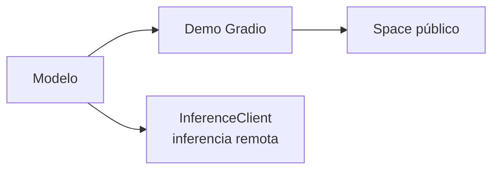

# Sesión 44 · Desplegar: Hub, Gradio y Spaces (14/12/2026)

> **Objetivo:** convertir un modelo propio en una demo pública y cerrar el curso con un proyecto.
>
> Formato: ~30 min de explicación · ~75 min de notebook guiado · ~15 min de proyecto final.

## Qué vas a aprender

| # | Al terminar la sesión serás capaz de… |
|---|---|
| 1 | Gestionar repositorios, versiones, ramas y modelos privados con `huggingface_hub` |
| 2 | Construir una demo con Gradio (`Interface` y `Blocks`) |
| 3 | Publicar un **Space** y conocer su hardware y límites |
| 4 | Hacer **inferencia remota** con `InferenceClient` sin descargar el modelo |

## Cuaderno de la sesión

[Abrir en Colab](https://colab.research.google.com/github/jmperez-profesor/hf/blob/main/docs/sesiones/sesion44_despliegue_gradio_spaces.ipynb){ .md-button } · [ver en el sitio](sesion44_despliegue_gradio_spaces.ipynb)

## 1 · `huggingface_hub`



```python
from huggingface_hub import HfApi, login

login()                       # token de acceso
api = HfApi()
api.create_repo("usuario/mi-modelo", private=False)
```

Gestiona repositorios, **versiones** (commits), **ramas** y **modelos privados/gated**.

## 2 · Gradio en pocas líneas

```python
import gradio as gr
from transformers import pipeline

clasificador = pipeline("sentiment-analysis")

def clasificar(texto):
    return clasificador(texto)[0]["label"]

gr.Interface(fn=clasificar, inputs="text", outputs="text").launch()
```

`Blocks` permite interfaces con varios componentes y estado.

## 2b · `Blocks`: flujo, disposición y componentes

`Blocks` es la API de bajo nivel: controlas **eventos**, **disposición** y **componentes**:

```python
import gradio as gr

def traducir(texto):
    return traductor(texto)[0]["translation_text"]

with gr.Blocks() as demo:
    gr.Markdown("## Traductor ES→EN")
    with gr.Row():
        entrada = gr.Textbox(label="Español", placeholder="Escribe aquí…")
        salida = gr.Textbox(label="English")
    btn = gr.Button("Traducir")
    btn.click(fn=traducir, inputs=entrada, outputs=salida)

demo.launch()
```

- **Disposición:** `gr.Row()`, `gr.Column()`, `gr.Tab()`, `gr.Accordion()` organizan los componentes.
- **Eventos:** `.click()`, `.change()`, `.submit()` disparan funciones (o con decoradores `@btn.click(...)`).
- **Componentes:** `Textbox`, `Image`, `Audio`, `Video`, `Slider`, `Dropdown`, `Checkbox`, `DateTime`, `Radio`, `Dataframe`, `Plot`… (más de 30).
- **Personalización:** `title`, `description`, `article`, `theme`, `examples` (lista de ejemplos precargados).

## 3 · Spaces

Un **Space** es un repositorio del Hub con una app (Gradio/Streamlit) que se sirve como web. Hardware gratuito (CPU), con **límites** de uso; GPU es de pago.

## 4 · Inferencia remota con `InferenceClient`

```python
from huggingface_hub import InferenceClient

client = InferenceClient()
print(client.text_classification("Me encanta", model="distilbert-base-uncased-finetuned-sst-2-english"))
```

Usa modelos alojados **sin descargarlos** (serverless; en 2026 también vía *Inference Providers*).

## 5 · Buenas prácticas

Licencias, sesgos conocidos y **documentación en la card**. Antes de publicar: ¿qué licencia tiene el modelo base? ¿qué limitaciones debo declarar?

## Práctica (notebook)

Publica en un **Space** el modelo de la sesión 36 o 38 con una interfaz **Gradio**. Ampliación (tipo Aitor): un **traductor ES↔EN** con `Blocks` y un `Dropdown`/`Radio` para elegir el sentido, usando los modelos `Helsinki-NLP/opus-mt-*`.

## Proyecto final (última hora)

**Presentación de 5 min** (individual o por pareja) de un Space que **combine al menos dos sesiones** del curso.

## Ejercicios de autoevaluación

**1.** ¿Para qué sirve `huggingface_hub`?

??? tip "Solución"
    Para gestionar repositorios del Hub por código: crear, versionar, ramas y modelos privados/gated.

**2.** ¿Qué diferencia hay entre `gr.Interface` y `gr.Blocks`?

??? tip "Solución"
    `Interface` es la vía rápida (una función → inputs/outputs); `Blocks` permite interfaces más complejas con estado y varios componentes.

**3.** ¿Qué es un Space?

??? tip "Solución"
    Un repositorio del Hub con una app (Gradio/Streamlit) servida como web pública, con hardware gratuito limitado.

**4.** ¿Qué ventaja tiene `InferenceClient`?

??? tip "Solución"
    Permite usar modelos alojados en remoto sin descargarlos, ideal para prototipar y para clientes ligeros.

**5.** ¿Qué debes comprobar antes de publicar un modelo?

??? tip "Solución"
    La licencia del modelo base, sus sesgos/limitaciones, y documentarlos en la model card.

## 🎬 Vídeos de la sesión

- [Deploying AI Models with Hugging Face](https://www.youtube.com/watch?v=R8h_gpSpEVU) — freeCodeCamp, 6h53m, inglés — curso end-to-end (Gradio, Spaces, despliegue). Para ampliación, con capítulos marcados.

## Observaciones

- `%pip install gradio huggingface_hub` en el Colab.
- Para publicar en Spaces necesitas **token de escritura** (`huggingface-cli login`).

## Fuentes y atribución

- Documentación de Gradio: https://www.gradio.app/guides/quickstart
- Apartados de `Blocks`, disposición y componentes adaptados de **Aitor Medrano** (CC BY-NC-SA 4.0): https://aitor-medrano.github.io/iabd/hf/gradio.html
